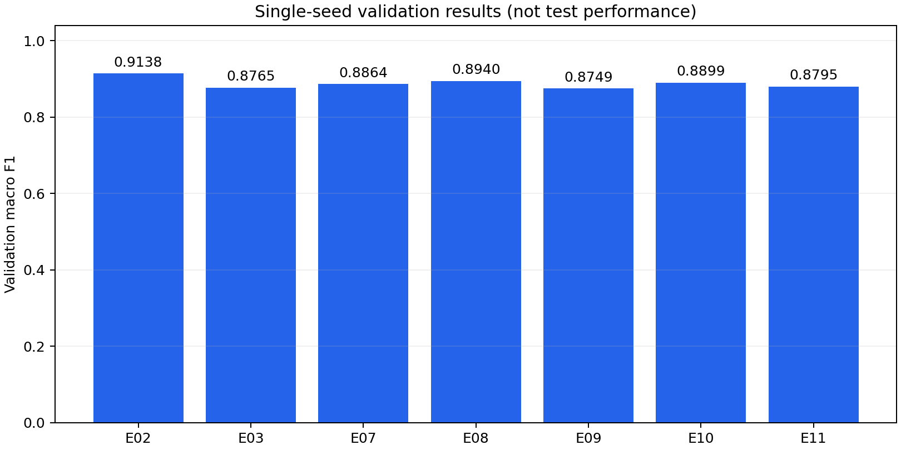

# Smartphone HAR

스마트폰 센서 구간으로 걷기·계단 오르기·계단 내려가기·앉기·서기·눕기를 분류하는 팀 프로젝트다. LSTM 구현·검증·9회 실험과 이전 MLP 수행 기록을 보관한다.

**현재 배정: 데이터 정회서 / MLP 한윤섭 / CNN 최승빈 / RNN 유재윤 / LSTM 이봉헌. 전처리 완료.** 최신 작업·원고 기준은 [공동 논문 안내](docs/team-paper/README.md)를 따른다. 아래 MLP 실험·보고서는 이봉헌이 이전에 수행한 기록이며 새 LSTM 결과를 뜻하지 않는다.

## 한윤섭 MLP 완료 자료 · 2026년 10월 12일

**[MLP 원고·압축 문단·실행 안내](docs/team-paper/contributions/02_mlp/README.md)** · [3seed 원자료](reports/mlp_yoonseop/summary.json)

동일한 첨부 시계열 캐시와 기존 fit 통계로 M01 seed 2026·2027·2028을 새로 실행했다. validation Macro F1은 **0.8646 ± 0.0125**, Accuracy 평균은 **86.67%**이며 156,230 파라미터다. 48개 코드 검사와 모델별 validation 1,775개 전체의 별도 프로세스 재로딩을 통과했다. 기존 이봉헌 MLP 점수와 분리된 이번 한윤섭 담당 결과다. 공식 test는 미평가다.

[**모델 3개·데이터·통계·전체 예측·코드가 포함된 Release ZIP**](https://github.com/kara320090/smartphone-har/releases/tag/yoonseop-mlp-v1) · [저장소에서 바로 보는 seed별 증빙](reports/mlp_yoonseop/run_evidence/) · [배포 전 내용 점검](reports/mlp_yoonseop/publication_audit.json)

## 수업 발표와 공동 논문 준비

**연구 기여 검토 · 10월 15일:** [결론이 약한 이유와 개정 방향](docs/research-contribution-review-20261015/README.md), [방법·결과·결론 수정 문단](docs/research-contribution-review-20261015/PROPOSED_SECTIONS_KO.md)을 추가했다. 하계 두 쪽 논문 세 편의 논증 구조를 다시 확인하고, 기존 LSTM 9회 실험을 재검산해 은닉 규모 축소의 효과와 한계를 본문에 연결하는 안을 작성했다. 소형 L02는 파라미터가 68.8% 적고 개발 평균 F1은 0.0098 높았지만 세 seed 중 한 번 낮아졌다. 이는 내용 검토안이며 아래 v7 HWP·학교 제출 서류의 새 버전은 아니다. 새 학습·공식 test 평가와 공동 대표 모델 교체는 없다.

**최신 연구 원고 v7 · 10월 14일:** [두 쪽 HWP·PDF·MD](docs/dcs-team-paper-research-v7/README.md)를 다른 대학의 두 쪽 논문 **4편·8쪽**과 비교해 개정했다. [실제 검토한 대학·제목·쪽과 반영 근거](docs/dcs-team-paper-research-v7/PROCEEDINGS_REVIEW_KO.md)를 남기고 연구 배경·Macro F1 정의·결과 해석·활용·결론을 보강했다. 모델 구조도·비교표·피험자 진단 그림을 연속 2단 본문에 배치했으며 두 쪽·본문 10pt·참고문헌 두 개와 기존 결과·저자를 유지했다. [현재 그림 설명·질의응답 19개](docs/dcs-team-paper-research-v7/PRESENTATION_QA_KO.md)를 제공한다. 새 학습·공식 test 평가는 없고 사사는 확인 후 기재 예정이다. 학교 지원 서류·학번·전화번호는 공개하지 않는다. [앞선 v6](docs/dcs-team-paper-research-v6/README.md)와 이전 기록은 보존한다.

**앞선 연구 초안 v2:** [연구 질문·오류 해석을 보강한 2쪽 HWP](docs/dcs-team-paper-research-v2/README.md), [행동군·피험자별 분석](docs/dcs-team-paper-research-v2/RESEARCH_ANALYSIS_KO.md), [21,300행 재분석 근거](reports/team_error_analysis/README.md)는 이전 기록으로 보존한다. 저자 정보와 원고를 검토할 때는 최신 v3를 사용한다.

**대학생 공식 양식 HWP:** [네 모델·구조 그림·공통 비교표를 넣은 2쪽 한글 초안](docs/dcs-team-paper-20261013/README.md)을 추가했다. 첨부 양식의 본문·장 순서·개체와 제목 서식을 보존하고 저장·재로딩·두 쪽 배치를 확인했다. 저자·소속 등은 확인 필요이며, 최종 대표 및 데이터 설명 검토 후 제출본을 확정한다.

**10월 13일 네 모델 취합:** MLP·CNN·RNN이 main에 합쳐졌다. [15회 예측 재계산·통합 비교표·공통 구조 그림](docs/team-paper/integrated-20261013/README.md)과 [실제 결과를 채운 통합 MD 초안](docs/team-paper/integrated-20261013/PAPER_DRAFT_KO.md)을 추가했다. 기준 네 모델 12회와 RNN 튜닝 R02 3회를 구분했고, 통합 코드 테스트 68개를 통과했다. 이어서 위 공식 양식 HWP 2쪽 편집을 완료했다. 최종 대표·test 규약·저자 정보와 최종 원고 검토는 남아 있다.

**공동 논문 전체 1~2쪽 취합에는 [LSTM 압축 원고·실제 구조 그림·결과 한 행](docs/team-paper/contributions/lstm-compact/README.md)을 우선 사용한다.** 222자 본문과 그림을 넣은 HWP 및 381자 설정 포함 참고 HWP를 제공한다. 기존 2쪽 HWP는 상세 검토 초안이며, 팀원 결과를 모두 담은 최종 제출본은 취합 후 작성한다.

[**강의자료에 맞춘 LSTM 수업 PPT 20장과 발표 원고**](docs/course-and-paper/README.md) · [커리큘럼 연결](docs/course-and-paper/COURSE_MAPPING_KO.md) · [공동 논문 취합 초안 MD](docs/course-and-paper/TEAM_PAPER_DRAFT_KO.md) · [팀 전달 안내](docs/course-and-paper/TEAM_INTEGRATION_KO.md) · [저장 모델 시연](docs/course-and-paper/RUN_DEMO_KO.md)

[PPT·Word·MD 묶음 다운로드](https://github.com/kara320090/smartphone-har/releases/tag/bongheon-course-paper-v1)

수업 발표는 LSTM 원리·구현·검증 과정을, 학술 발표는 팀의 네 모델 비교를 중심으로 준비한다. Word는 확인된 LSTM 결과를 채운 **내부 취합 초안**이다. 이어서 사용자 제공 대학생 공식 양식에 맞춘 [**2쪽 HWP 취합 초안과 제출 확인 사항**](docs/dcs-student-paper/README.md)을 추가했다. 다른 모델 결과·저자 정보·최종 test·최종 투고 확정은 남아 있다. 강의자료와 공식 양식 원본은 배포하지 않는다.

## 이봉헌 LSTM 완료 자료 · 2026년 10월 9일

기본·소형·Dropout 조건을 seed 2026·2027·2028에서 **총 9회** 학습했다. 공동 비교에 제공할 L01의 validation Macro F1은 **0.8813 ± 0.0195 (seed 표본 SD)**, Accuracy 평균은 **88.32%**다. 39개 코드 테스트와 작은 LSTM의 174회 수치미분 검사를 통과했고, 각 모델을 새 프로세스에서 불러와 validation 1,775개 전체의 예측을 대조했다. 공식 test는 미평가다.

[**22쪽 Word·PDF·MD와 20장 PPT**](docs/lstm-report/README.md) · [팀 논문용 원고·구조표·결과표](docs/team-paper/contributions/05_lstm_bongheon.md) · [재현·검증·추론 명령](docs/lstm-report/RUN_GUIDE_LSTM_KO.md) · [원자료](reports/lstm/) · [9개 모델과 상세 근거 Release](https://github.com/kara320090/smartphone-har/releases/tag/bongheon-lstm-v1)

L02·L03은 개인 심화 분석이다. 결과 후 공동 비교용 L01을 교체하지 않았다. 같은 seed의 L01·L03 **학습 전** 가중치 일치를 확인했다. 아래 MLP 결과는 이전 역할의 실험 기록이다.

## 이전 MLP 수행 기록

**MLP 2종 · 후속 학습 24회 · 테스트 24개 통과 · 실행된 노트북 3개**

> 최신 보강은 기존 7조건×3seed와 초기값 일치 Dropout 대조 3회다. 검증 5명, 1,775개 구간을 고정했다. 공식 시험 평가와 전체 팀 모델의 비교는 후속 단계다. 아래 원래 결과 표는 v1의 seed 2026 기록이다.

## 최신 심화 검증

잘못된 분할 인덱스의 묵시적 변환과 원본 검증 입력의 정렬 누락을 재현하고 수정했다. 같은 seed에서도 Dropout 모델의 초기 Dense 가중치가 달라지는 것을 확인하여 초기값을 복사한 E08W 대조를 추가했다. 실제 결함과 의도적인 수학 오류 주입을 구분한다.

[**21쪽 심화 보고서·20장 PPT·MD·질의응답 34개**](docs/process-report/README.md) · [전체 실험 근거](reports/process_audit/) · [코드·학습 모델·문서 v2 릴리스](https://github.com/kara320090/smartphone-har/releases/tag/bongheon-process-v2)

E02의 3seed 검증 Macro F1은 **0.9046 ± 0.0123 (표본 SD)**이다. seed마다 최고 조건이 달라졌다. SD는 고정 사람 분할의 학습 변동이며 새 사람 모집단의 신뢰구간이 아니다.

## 먼저 볼 문서

| 목적 | 문서 |
|---|---|
| 팀 공동 논문 준비와 개인 원고 작성 | [역할별 작업·결과물·작성 양식·취합 절차](docs/team-paper/README.md) |
| 이전 MLP 작업과 완료 내역 확인 | [이봉헌 담당 업무 정리](docs/BONGHEON_WORK_SUMMARY.md) |
| 현재 LSTM 보고서와 PPT | [22쪽 Word·20장 PPT·질의응답·원고](docs/lstm-report/README.md) |
| 이전 MLP 심화 보고서와 PPT | [21쪽 Word·20장 PPT·질의응답·작업 과정](docs/process-report/README.md) |
| 최초 구현 설명과 보고서 | [v1 Word·PPT·MD 원문](docs/personal-report/README.md) |
| 처음 실행하기 | [시작 안내](START_HERE_KO.md) · [상세 설치와 실행](docs/RUN_GUIDE_KO.md) |
| 실제 점수와 학습 곡선 확인 | [실험 결과](reports/RESULTS_KO.md) · [가설과 해석](docs/EXPERIMENT_NOTES_KO.md) |
| 팀원 코드와 연결하기 | [입력 계약과 인계](docs/HANDOFF_KO.md) |
| 발표와 진행 준비 | [발표 원고](docs/PRESENTATION_KO.md) · [팀장 작업표](docs/TEAM_TASKS_KO.md) |
| 전체 문서 찾기 | [문서 목차](docs/README.md) |

## 빠른 시작

검증 환경은 **Windows CPU / Python 3.11.9 / TensorFlow 2.21.0 / Keras 3.15.1**이다. PowerShell에서 다음 순서로 실행한다.

```powershell
git clone https://github.com/kara320090/smartphone-har.git
cd smartphone-har
py -3.11 -m venv .venv
.\.venv\Scripts\python.exe -m pip install -r requirements.txt
.\.venv\Scripts\python.exe scripts/download_data.py
.\.venv\Scripts\python.exe -m src.train --config configs/E02.json --smoke --runs-dir runs/smoke
```

마지막 명령은 실제 학습 60개·검증 30개로 2 epoch를 실행하는 연결 검사다. 정식 7개 실험의 실행·검증 명령과 노트북 사용법은 [상세 안내](docs/RUN_GUIDE_KO.md)에 있다. 기존 실행 폴더는 덮어쓰지 않으므로 재실행 시 새 `--runs-dir`을 지정한다.

## 최초 단일 seed 실험 결과

| ID | 조건 | 검증 Accuracy | 검증 Macro F1 |
|---|---|---:|---:|
| E02 | 특징 MLP 기준 | 0.9161 | **0.9138** |
| E03 | 시계열 MLP | 0.8783 | 0.8765 |
| E07 | 표준화 제거 | 0.8873 | 0.8864 |
| E08 | Dropout 0.3 | 0.8952 | 0.8940 |
| E09 | 학습률 0.0003 | 0.8772 | 0.8749 |
| E10 | 학습률 0.003 | 0.8913 | 0.8899 |
| E11 | PCA 95% | 0.8811 | 0.8795 |

학습 16명 5,577개와 검증 5명을 분리했다. 표준화와 PCA는 학습 데이터로만 계산했다. 공통 설정은 batch 64, 최대 40 epoch, 검증 손실 기준 patience 6이며 최저 검증 손실의 가중치를 복원했다. [전체 결과와 해석](reports/RESULTS_KO.md)을 함께 확인한다.



## 학습 모델 다운로드

[**봉헌 담당 v1 릴리스 — 코드·모델·결과 ZIP**](https://github.com/kara320090/smartphone-har/releases/tag/bongheon-part2-v1)

ZIP에는 `runs/formal/`의 학습 모델 7개와 전처리·설정·예측 기록이 포함된다. Git 저장소에는 코드·문서·요약 근거를 보관하고, 원 데이터와 가상환경은 각 환경에서 준비한다. 저장 모델 사용 순서는 [시작 안내](START_HERE_KO.md#저장된-모델-사용)에 정리했다.

## 폴더 구성

```text
src/          MLP, 공통 학습, 참조 데이터 어댑터, 수학·재로딩 검증
configs/      E02·E03·E07–E11의 고정 실험 설정
scripts/      공식 데이터 다운로드, 노트북 생성, 로컬 실행
tests/        데이터 누수·모델·기울기·학습·저장 검증
notebooks/    실제 실행한 설명 노트북 3개
reports/      실험 결과, 그래프, 수치 검증 기록
docs/         담당 업무, 상세 실행, 팀 인계, 해석, 발표
```

## 검증과 다음 연결

최초 검증은 테스트 8개, 노트북 3개, TFRecord 200개 표본 왕복, 모델 7개 예측 재현이다. 후속 보강에서는 테스트 24개, 작은 ReLU 네트워크 수치미분 138회, 기존 7조건 재학습 예측 일치, 새 모델 24개 재로딩을 확인했다. [최초 기록](reports/VERIFICATION_KO.md)과 [후속 기록](reports/process_audit/summary.json)을 구분해 제공한다.

①의 데이터 모듈, ③의 비교 모델, ④의 반복·시험 평가, ⑤의 추론·시연은 [공통 계약](docs/HANDOFF_KO.md)에 맞춰 연결한다. 실제 팀원 환경에서의 실행 확인은 공동 작업표에 남겨두었다.

## 데이터 출처

[UCI Human Activity Recognition Using Smartphones](https://archive.ics.uci.edu/dataset/240/human+activity+recognition+using+smartphones), Reyes-Ortiz 외, DOI **10.24432/C54S4K**, **CC BY 4.0**. 학습·분할·실험 구성은 제공된 10주 프로젝트 상세계획서를 따른다. 라이브러리 문서와 재현 조건은 [상세 안내](docs/RUN_GUIDE_KO.md)에 정리했다.

## 유재윤 RNN 담당 결과

[실행·업로드 안내](RNN_START_HERE_KO.md) · [담당 보고서](docs/rnn-report/REPORT_KO.md) · [팀 기여 원고](docs/team-paper/contributions/04_rnn/README.md) · [실험 원자료](reports/rnn/run_evidence/README.md)

R01·R02·R03을 세 seed에서 총 9회 수행했다. 기준 R01의 검증 Macro F1은 **0.7191 ± 0.0586**, 튜닝 선택 R02는 **0.7715 ± 0.0675**다. 공식 test는 미평가다. 코드·노트북·문서·지표는 Git에, 9개 저장 모델·초기 가중치·공유 입력 데이터는 [RNN Release](https://github.com/kara320090/smartphone-har/releases/tag/yu-jaeyun-rnn-v1)에 게시한다.
