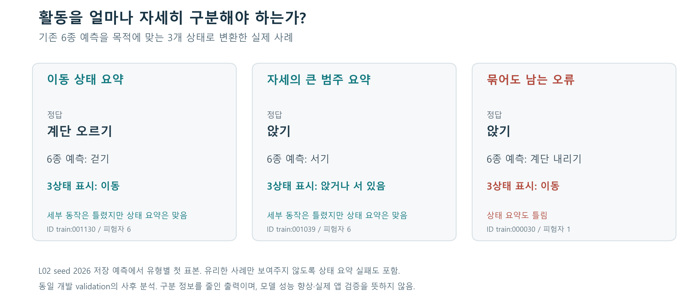

# 활용으로 연결하는 연구 질문: 서비스에 필요한 행동 구분 수준

2026-10-15 · 기존 저장 예측을 이용한 탐색적 사후 분석. 새 학습·추론·공식 test 평가는 없다. 이 문서는 활용 방향과 근거 검토안이며, 실제 스마트폰 앱을 구현·검증했다는 보고서나 새 HWP 제출본이 아니다.

## 사용자가 할 수 있는 일

권장 활용은 **스마트폰 센서 구간의 활동 상태 요약**이다. 예를 들어 일상 활동 기록 화면에 ‘이동’, ‘앉거나 서 있음’, ‘누워 있음’ 정도의 상태만 필요한 경우, 걷기와 계단 오르기·내리기를 항상 따로 출력할 필요는 없다. 반대로 계단 이용을 따로 기록하거나 앉은 시간을 측정하는 기능은 세부 동작 구분이 필요하다.

이때 연구가 제공하는 결과는 앱 이름을 붙인 활용 가능성 목록보다 구체적이다. **어떤 분류 오류가 서비스의 출력까지 바꾸는지 측정하고, 서비스가 요구하는 구분 수준에 맞춰 검증할 모델 후보를 정할 수 있다.**

## 실제 예측에 적용한 출력 규칙

| 원래 6종 출력 | 3상태 요약에 표시할 값 |
| --- | --- |
| 걷기·계단 오르기·계단 내리기 | 이동 |
| 앉기·서기 | 앉거나 서 있음 |
| 눕기 | 누워 있음 |

누워 있음을 수면으로 해석하지 않는다. 정답과 저장된 6종 argmax 예측에 같은 고정 매핑을 적용했다. 확률을 더해서 다시 argmax를 구하거나 신뢰도 임계값으로 선택한 방식이 아니다. 실제 시간 정보가 없는 구간들을 이어 붙여 하루의 행동·지속시간을 만든 것도 아니다.



그림은 L02 seed 2026에서 각 유형에 해당하는 첫 표본이다. 계단 오르기를 걷기로 예측한 사례는 6종에서 오류지만 ‘이동’ 상태에서는 맞다. 앉기를 서기로 예측한 사례는 ‘앉거나 서 있음’에서는 맞지만, 앉은 시간 기록에는 여전히 사용할 수 없는 구분이다. 앉기를 계단 내리기로 예측한 사례는 상태 요약에서도 틀린다. 표본별 ID와 원자료는 `FIGURE_EXAMPLES.json` 및 분석 CSV로 추적할 수 있다.

## 전 모델에서 확인한 결과

기존 네 기준 모델의 12회와 LSTM 보조 L02·L03의 6회를 포함한 총 18회 예측을 읽었다. 1,775개 구간의 ID·사람·정답 순서가 동일함을 검사하고, 6종·3상태·2상태의 전체 54개와 피험자별 270개 지표를 재계산해 scikit-learn과 대조했다. 두 단계 중 유리한 결과만 남기지 않고 둘 다 보관했다.

| 기준 모델 | 파라미터 | 6종 Macro F1 평균 | 3상태 Macro F1 평균 | 3상태 오류 수, seed 2026/2027/2028 |
| --- | ---: | ---: | ---: | --- |
| MLP M01 | 156,230 | 0.8646 | 0.9998 | 1 / 0 / 0 |
| CNN C01 | 85,574 | 0.8889 | 0.9994 | 1 / 2 / 1 |
| RNN R01 | 1,542 | 0.7191 | 0.9960 | 14 / 4 / 5 |
| LSTM L01 | 21,222 | 0.8813 | 0.9980 | 1 / 7 / 4 |

각 seed의 분모는 1,775개다. 6종과 3상태는 **서로 다른 과제**이며 점수 차이를 모델 성능 개선으로 해석하지 않는다. 세 반복을 합친 오류 사건 중 3상태 안의 세부 동작 혼동이 차지한 비율은 MLP 99.9%, CNN 99.3%, RNN 98.4%, LSTM 98.1%였다. 반복마다 같은 구간을 다시 예측했으므로 서로 독립인 새 표본·사용자 5,325개를 평가한 것이 아니다.

소형 LSTM L02는 6,630개 파라미터로 3상태 F1 평균 0.9982, 오류 4·2·4개를 보였다. 이 결과를 기준 L01 대신 공동 순위표에 끼워 넣지 않았다. 모든 조건의 seed 평균·표본 SD와 사람별 값은 [원자료](../../reports/output_granularity/)에 있다.

## 이 결과가 바꾸는 실제 선택

**첫째, 제품에서 무엇을 표시할지 먼저 정한다.** 활동의 큰 상태만 필요한 기능이라면 세부 행동 오류가 실제 사용자 표시까지 바꾸는지 평가할 수 있다. 위 규칙은 분류 정보를 줄이므로, 계단 사용 횟수나 앉은 시간처럼 줄어든 정보가 필요한 기능에는 그대로 적용할 수 없다.

**둘째, 모델 후보를 다시 검토할 근거가 생긴다.** 6종 F1이 낮았던 기준 RNN도 3상태에서는 평균 0.9960이었다. 3상태만 필요한 서비스에서 작은 모델을 검토할 이유가 생긴다. 그렇다고 RNN과 큰 모델이 동등하거나 실제 기기에서 더 빠르다고 입증한 것은 아니다. 후보를 정할 때 허용 오류와 기기 조건을 별도로 정해야 한다. LSTM만 유리하게 보이도록 다른 모델의 결과를 제외하지 않았다.

**셋째, 같은 사람에게서 무엇이 어려운지 더 정확히 설명한다.** 세부 동작에서 낮은 점수가 큰 상태에서도 반드시 낮은 점수를 뜻하지는 않는다. 사람별 지표를 출력 수준마다 다시 확인했다. 그러나 다른 과제의 점수가 높아졌다는 이유로 기존 6종 과제의 사용자 취약성을 해결했다고 쓰지 않는다.

## 논문에서 쓸 수 있는 핵심 주장

> 고정된 개발 분할에서 네 기준 모델의 분류 오류는 대부분 동일 활동 상태 안의 세부 동작 혼동이었다. 따라서 스마트폰 행동 인식 모델의 활용 여부를 판단할 때는 6종 평균 성능뿐 아니라 서비스가 요구하는 출력 수준에서 발생하는 오류를 함께 평가할 필요가 있다. 활동 상태 요약을 위한 소형 모델의 후속 검증 가능성을 확인했으며, 계단 이용이나 앉은 시간처럼 세부 구분이 필요한 기능은 별도로 검증해야 한다.

권장 제목의 예는 **‘출력 구분 수준을 고려한 스마트폰 행동 인식 모델의 비교와 활용 가능성 분석’**이다. 새 계층형 신경망이나 새로운 학습 알고리즘을 개발한 것으로 표현하지 않는다. 현재 실험은 기존 분류 출력의 고정 집계다.

## 실용성을 입증할 다음 검증

1. 활동 요약이라는 사용 목적과 허용 오류를 먼저 정하고 출력 수준을 고정한다. 이번 매핑은 결과를 확인한 뒤 수행한 사후 분석임을 명시한다.
2. 같은 사람 분할·입력에서 단순 센서 특징 기반 임계값 또는 선형 기준과 비교한다. 큰 활동 구분이 쉬운 과제일 수 있으므로, 이 용도에 순환 신경망이 필요한지도 검증해야 한다.
3. 새로운 사람 분할에서 재학습과 내부 checkpoint 선택을 분리해 평가한다. 공식 test는 기존 합의대로 보류한다.
4. 실제 연속 기록 기능으로 확장할 때는 센서 전처리의 일치, 휴대 위치, 일상 전환 동작·미등록 행동, 누락·중복 구간, 실제 기기의 지연·전력, 지속시간 오차를 측정한다. 구간 분류만으로 일별 기록이나 실시간 서비스를 검증했다고 쓰지 않는다.

한 번에 모든 앱 기능을 붙이기보다 **실제 저장 구간 → 6종 예측 → 서비스용 상태 표시 → 정답 대비 오류 확인**의 시연을 먼저 만들 수 있다. 이 문서의 그림은 그 표시 동작을 실제 표본으로 설명하며, 실행 가능한 앱이나 실시간 입력 시연은 아니다.

## 데이터 범위·재현

[UCI 공식 설명](https://archive.ics.uci.edu/dataset/240/human+activity+recognition+using+smartphones)에 따르면 원자료는 허리에 스마트폰을 고정한 30명의 여섯 행동을 기록했고, 제공 구간은 50Hz·128시점·50% 중첩이다. 이 조건의 개발 결과를 손에 든 휴대폰·주머니·가방·실생활 전체에 그대로 일반화하지 않는다. 활동 전환 라벨과 연속 원신호가 포함된 갱신 데이터셋은 별도로 제공된다.

공통 개발 분할은 학습 16명, 검증 5명·1,775구간이다. 검증은 학습 epoch 선택에도 사용했다. 지금의 높은 묶음별 점수는 독립적인 실제 사용자 평가가 아니다.

```powershell
python tools/analyze_output_granularity.py --output reports/output_granularity_recheck
python tools/make_output_granularity_figure.py
```

분석에는 LSTM Release의 `runs/lstm`과 저장소의 MLP·CNN·RNN 예측 파일이 필요하다. 새 출력 폴더를 사용해 이전 결과를 보존한다. 분석 JSON에 입력 예측 SHA256, 매핑, 전체 혼동행렬, 지표 검사 범위와 한계를 기록했다. 소형 모델 학습이나 공식 test 평가를 새로 수행하지 않았다.
