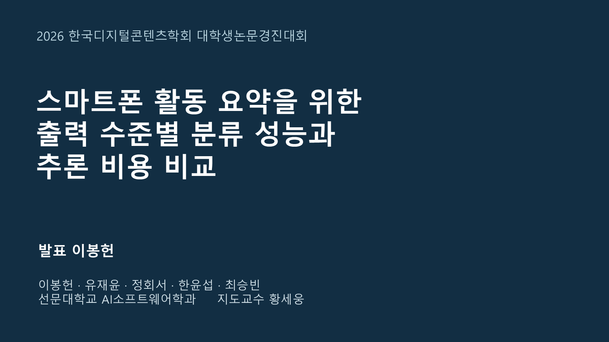
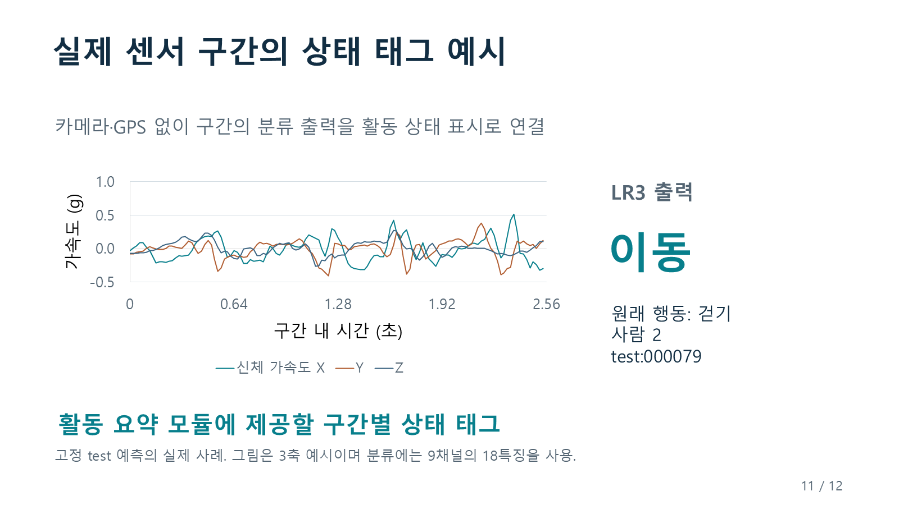

# v10.1 학술대회 발표 자료

발표자 이봉헌. 논문 「스마트폰 활동 요약을 위한 출력 수준별 분류 성능과 추론 비용 비교」 v10.1의 공식 test 결과를 사용한다.

- `DCS_2026_학술대회발표_v10_1.pptx`: 본문 12장과 질의응답용 부록 8장. 표·차트·텍스트 편집 가능. 발표 대본과 출처를 발표자 노트에 수록.
- `발표대본_v10_1.md`: 본문 7분 목표 대본, 슬라이드별 시간, 30초 설명, 3분 압축 버전, 부록 설명.
- `심사위원_예상질문답변_v10_1.md`: 36개 질문의 즉답, 근거, 꼬리질문 대응, 슬라이드 연결.
- `PRESENTATION_DATA.json`: 고정 결과 파일에서 추출한 수치와 출처 해시.
- `SLIDE_NOTES.json`, `QA_DATA.json`: 대본과 질문 자료의 구조화된 원문.

## 발표 운영

[학회 안내](https://dcs.or.kr/homepage/custom/submit)의 대학생 분야는 포스터이며 발표·질의응답에 10분을 배정한다(2026-10-19 확인). 이 자료의 7분 설명과 3분 질의응답은 리허설 구성이다. PPT는 포스터 앞 설명·리허설 및 화면 사용이 허용되는 상황의 보조 자료로 활용한다. 실제 포스터 인쇄물은 별도 형식이다.

본문 1~12장으로 설명하고 12장의 결론 화면에서 질문을 받는다. 필요하면 부록 번호로 이동한다. 원고를 읽는 속도에 맞춰 리허설 시간을 조정한다.

## 연구 근거

- [기준 논문 v10.1](https://github.com/kara320090/smartphone-har/blob/8b68cb251084ac7ced2557d9472f0889a1d5a45b/docs/dcs-team-paper-research-v10-1/DCS_TEAM_PAPER_KO.md)
- [공식 test 수치](https://github.com/kara320090/smartphone-har/blob/8b68cb251084ac7ced2557d9472f0889a1d5a45b/reports/confirmatory_20261019/summary.csv)
- [대응 차이](https://github.com/kara320090/smartphone-har/blob/8b68cb251084ac7ced2557d9472f0889a1d5a45b/reports/confirmatory_20261019/paired_differences.csv)
- [모델과 상세 근거 Release](https://github.com/kara320090/smartphone-har/releases/tag/bongheon-team-research-paper-v10)
- [논문 v10.1 Release](https://github.com/kara320090/smartphone-har/releases/tag/bongheon-team-research-paper-v10.1)

슬라이드와 원고는 새로운 학습이나 test 선택을 수행하지 않고 고정된 결과를 사용한다. 0.9994는 Macro F1, 0.073ms는 준비된 센서 구간의 PC 처리 시간이다. 활용 설명은 구간별 상태 태그와 출력 설계에 근거한다.

## 감사의 글

본 연구는 2026년도 과학기술정보통신부 및 정보통신기획평가원의 ‘SW중심대학지원사업’의 연구 결과로 수행되었습니다(2024-0-00023).

## 슬라이드 미리 보기

미리 보기 20장은 `previews/`에 있다. 연구 수치와 대본의 근거는 발표자 노트 및 원 자료 링크에서 확인할 수 있다.
