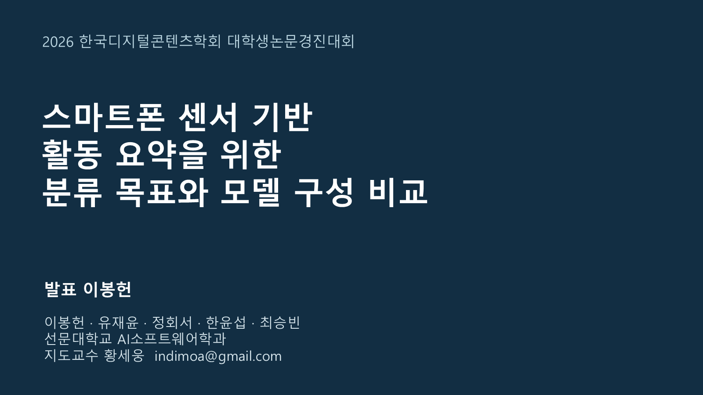

# 학술대회 포스터 발표 자료 · v10.3

**스마트폰 센서 기반 활동 요약을 위한 분류 목표와 모델 구성 비교**

발표자 이봉헌 · 선문대학교 AI소프트웨어학과 · 지도교수 황세웅

- `DCS_2026_학술대회발표_v10_3.pptx`: 본문 12장·질의응답 부록 8장, 발표자 노트 포함
- [포스터 발표 대본](포스터발표_대본_v10_3.md): 약 7분 설명·3분 질의응답 목표, 30초 핵심 설명, 슬라이드별 대본
- [심사위원 예상 질문과 답변 38개](심사위원_예상질문답변_v10_3.md)
- `SLIDE_NOTES.json`: PPT 발표자 노트와 대본의 공통 원문
- `PRESENTATION_DATA.json`: 고정 결과·차트 수치와 출처 해시

2026-10-23 확정한 제목을 표지, 목차, 첫 인사말과 발표자 노트에 통일했다. 본문·실험 수치·차트는 v10.2와 같다.

대본은 포스터 앞 설명과 리허설을 위한 자료다. PPT는 화면 사용이 허용되는 상황의 보조 자료이며 인쇄용 포스터와 구분한다. 7분은 목표 시간으로 발화 속도에 따라 조정한다. 학회 발표 방식·시간에 대한 기존 안내 근거는 [학회 안내](https://dcs.or.kr/homepage/custom/submit)의 2026-10-19 확인 내용이다.

[기준 논문](../dcs-team-paper-research-v10-3/DCS_TEAM_PAPER_KO.md) · [고정 공식 test 수치](../../reports/confirmatory_20261019/summary.csv) · [실험 근거 Release](https://github.com/kara320090/smartphone-har/releases/tag/bongheon-team-research-paper-v10)

