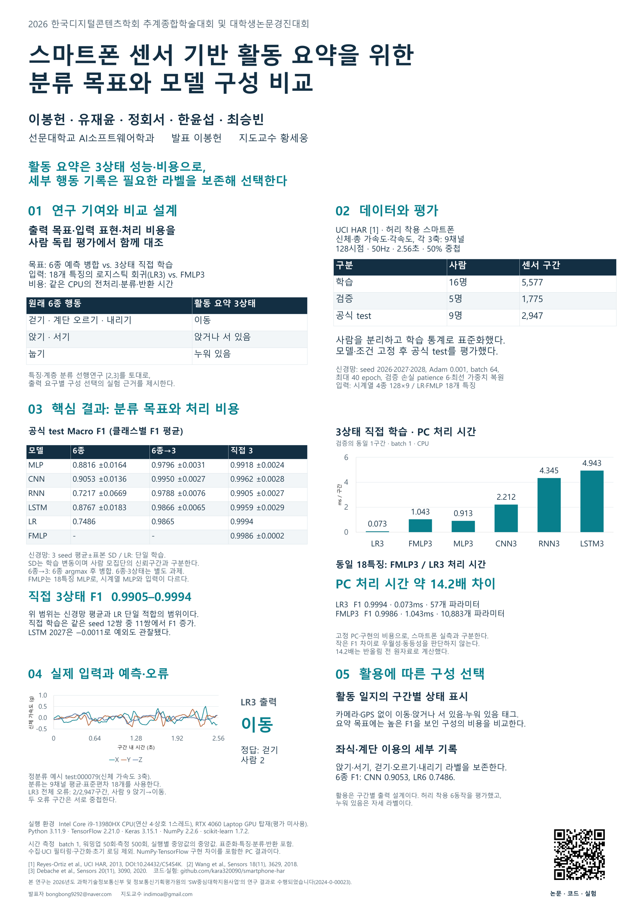

# 학술대회 인쇄용 포스터 · v10.3-r1

**스마트폰 센서 기반 활동 요약을 위한 분류 목표와 모델 구성 비교**

2026-10-23 심사 관점 검토를 반영한 **r1**입니다. [검토 결과와 보완 17항목](REVIEW_KO.md) · [원자료 재계산 근거](REVIEW_EVIDENCE.json). 논문 v10.3의 결과는 유지했습니다.

사용자가 확정한 **A0 세로형 841×1189mm, 1장**입니다. 논문 v10.3의 제목·저자·공식 test 수치·지도교수 이메일·사사 문구를 사용했습니다.

- [인쇄용 PDF](DCS_2026_학술대회포스터_v10_3_A0.pdf)
- [편집 가능한 PowerPoint 원본](DCS_2026_학술대회포스터_v10_3_A0.pptx)
- [포스터 앞 30초·3분 설명](포스터_현장설명_대본_v10_3.md)
- [논문 원문](https://github.com/kara320090/smartphone-har/blob/main/docs/dcs-team-paper-research-v10-3/DCS_TEAM_PAPER_KO.md) · [발표 보조 PPT·상세 질의응답](https://github.com/kara320090/smartphone-har/blob/main/docs/dcs-conference-presentation-v10-3/README.md)

## 인쇄

인쇄소에는 PDF를 전달하고 **A0 세로, 실제 크기 100%, 단면 컬러**로 요청합니다. 파일 안에 여백이 포함되어 있습니다. 별도 재단선이나 추가 도련은 없습니다. PowerPoint는 글꼴 ‘맑은 고딕’이 있는 환경에서 편집하고, 수정 후 PDF를 다시 확인합니다.

학회 공식 공지에서는 포스터 발표 방식과 시간을 안내하며 인쇄 크기는 확인되지 않았습니다. 이번 A0 규격은 사용자가 선택한 제작 규격입니다. [공식 안내](https://dcs.or.kr/homepage/custom/submit), 2026-10-23 확인.

## 내용

연구 질문과 사람 단위 평가 조건, 공식 test F1 비교표, CPU 처리 시간 그래프, 실제 센서 구간의 예측 예시, 활용에 따른 구성 선택을 배치했습니다. 표 3개와 차트 2개는 PowerPoint에서 편집 가능합니다. QR은 논문과 실험 근거가 있는 GitHub 저장소로 연결됩니다.

3상태의 높은 F1 분포와 처리 비용 차이를 함께 해석합니다. 신경망은 세 seed 평균±표본 SD, LR은 단일 학습입니다. 6종과 3상태는 서로 다른 과제이며, 비용은 고정 환경의 PC 결과입니다. 활용은 센서 구간의 출력 설계로 설명합니다.

`POSTER_DATA.json`은 표·차트의 수치, 실제 센서 예시와 출처 해시를 보관합니다. v10.3 논문의 고정 실험 결과를 그대로 사용했습니다.

