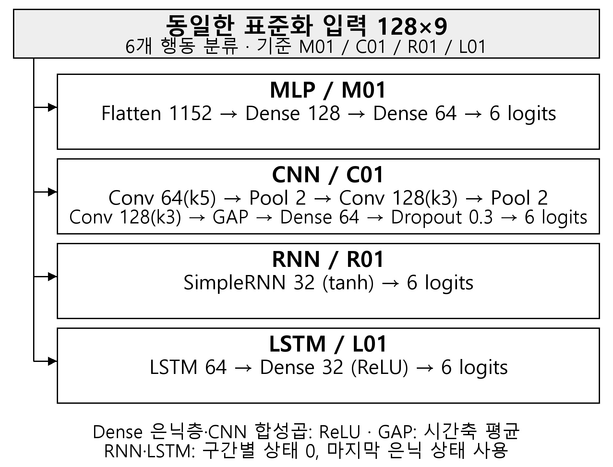

# 스마트폰 행동 인식 신경망의 동일 피험자 분할 기반 검증 비교

저자 명단 및 저자 순서 확인 필요
학교·학과 확인 필요
저자 이메일·교신저자 및 이메일 확인 필요
†지도교수(Supervisor) : 확인 필요

## 1. 연구 배경

스마트폰 센서 기반 행동 인식에서는 시간축 정보를 처리하는 모델 구성과 사용자별 신호 차이를 고려해야 한다. 센서 행동 인식의 CNN·LSTM 구조는 이미 연구되었다[4]. 본 연구는 새로운 알고리즘 제안보다 동일 입력·사람 분할에서 네 신경망 구성의 개발 검증 성능과 모델 규모를 비교하는 데 목적이 있다.

## 2. 연구 내용

UCI HAR[1]의 128시점×9채널 센서 구간과 6개 행동을 사용하였다. 채널은 body_acc, body_gyro, total_acc의 xyz 순서다. 제공 구간에는 기존 신호 처리·윈도잉이 적용되어 있다. 학습 16명·5,577구간과 검증 5명·1,775구간을 분리했으며 검증 사람은 1·6·14·21·23이다.

분할의 사람·표본 ID 중복을 검사하고 저장된 fit 평균·표준편차로 표준화를 한 번 적용하였다. 통계를 재추정하거나 PCA를 적용하지 않았다. 네 모델의 실제 분할 목록, 채널·라벨 순서 및 데이터·통계 해시가 일치함을 확인하였다.

MLP는 입력을 1,152차원으로 펼친 뒤 Dense 128·64 ReLU를 사용하였다. CNN은 시간축 Conv1D 64(k5)·128(k3)·128(k3), 첫 두 합성곱 뒤 Pool 2, GAP, Dense 64 ReLU와 Dropout 0.3으로 구성하였다. SimpleRNN은 tanh 은닉 32, LSTM[2,3]은 은닉 64와 Dense 32 ReLU를 사용하였다. 순환 모델은 구간별 상태를 0으로 초기화하고 마지막 상태로 분류한다. 모든 출력은 6 logits이다(그림 1).

그림 1. 비교 모델의 실제 기본 구성

Adam 학습률 0.001, batch 64, 최대 40 epoch로 학습하고 validation loss 기준 patience 6으로 최선 가중치를 복원하였다. 손실은 logits 기반 희소 다중 분류 교차 엔트로피다. 각 기준 조건을 seed 2026·2027·2028에서 반복하여 총 12회 평가하였다. CNN 외의 기본 모델 Dropout은 0이다.

표 1. 개발 검증 성능과 모델 규모

| 모델 | 조건 | 파라미터 | Accuracy 평균 ± SD | Macro F1 평균 ± SD |
| --- | --- | ---: | ---: | ---: |
| MLP | M01 | 156,230 | 0.8667 ± 0.0117 | 0.8646 ± 0.0125 |
| CNN | C01 | 85,574 | 0.8888 ± 0.0116 | 0.8889 ± 0.0127 |
| RNN | R01 | 1,542 | 0.7356 ± 0.0497 | 0.7191 ± 0.0586 |
| LSTM | L01 | 21,222 | 0.8832 ± 0.0194 | 0.8813 ± 0.0195 |

표 1의 SD는 같은 사람 분할에서 세 seed의 표본 표준편차다. CNN과 LSTM의 Macro F1 평균 차이는 0.0076로 관찰되었다. 저장 예측에서 혼동행렬·지표를 다시 계산해 게시 수치와 일치함을 확인했고, 병합 코드 테스트 68개가 통과하였다.

기준 RNN은 R01이다. 개인 튜닝 선택 R02(은닉 64, 5,126개)의 Macro F1은 0.7715 ± 0.0675로 별도 확인하였다. 모델별 탐색 예산·선택 규칙이 동일하지 않아 이 결과를 기준 비교와 구분하였다.

## 3. 현실적 제한 조건에 대한 검토

첫째, validation은 epoch 선택에도 사용한 개발 자료이며 공식 test는 미평가다. 단일 사람 분할·세 seed의 SD는 미지 사용자 모집단의 신뢰구간이나 일반화 우월성의 증거가 아니다.

둘째, 파라미터 수·은닉 크기·분류 헤드·Dropout이 서로 다르다. 따라서 게이트 유무만 바꾼 통제 비교가 아닌 고정 구성의 비교다. 개인 PC·일부 라이브러리 버전도 달라 시간 기록으로 모델 속도 순위를 정하지 않았다.

## 4. 기대효과 및 활용

동일한 데이터 규격과 예측 기반 평가를 이용해 모델 규모와 개발 성능을 함께 검토할 수 있다. 저장된 구조·설정·분할·예측·해시는 팀 결과의 취합과 재현에 활용한다. 상세 수학 검산·오류 분석·보조 실험은 개인 보고서와 수업 발표 자료로 제공한다.

## 5. 결론

동일 사람 분할에서 네 기준 구성의 반복 검증 결과를 취합하였다. CNN과 LSTM의 높은 평균과 규모 차이를 관찰했으나 구성과 개발 지표의 한계가 있다. 후속 과제는 동일 탐색 예산·선택 규칙을 고정한 공식 test의 일반화 검증이다.

## 참고 문헌

[1] UCI Machine Learning Repository, “Human Activity Recognition Using Smartphones,” 2013. DOI: 10.24432/C54S4K.

[2] S. Hochreiter and J. Schmidhuber, “Long Short-Term Memory,” Neural Computation, Vol. 9, No. 8, pp. 1735–1780, 1997.

[3] F. A. Gers, J. Schmidhuber, and F. Cummins, “Learning to Forget: Continual Prediction with LSTM,” Neural Computation, Vol. 12, No. 10, pp. 2451–2471, 2000.

[4] F. J. Ordóñez and D. Roggen, “Deep Convolutional and LSTM Recurrent Neural Networks for Multimodal Wearable Activity Recognition,” Sensors, Vol. 16, No. 1, 115, 2016.
