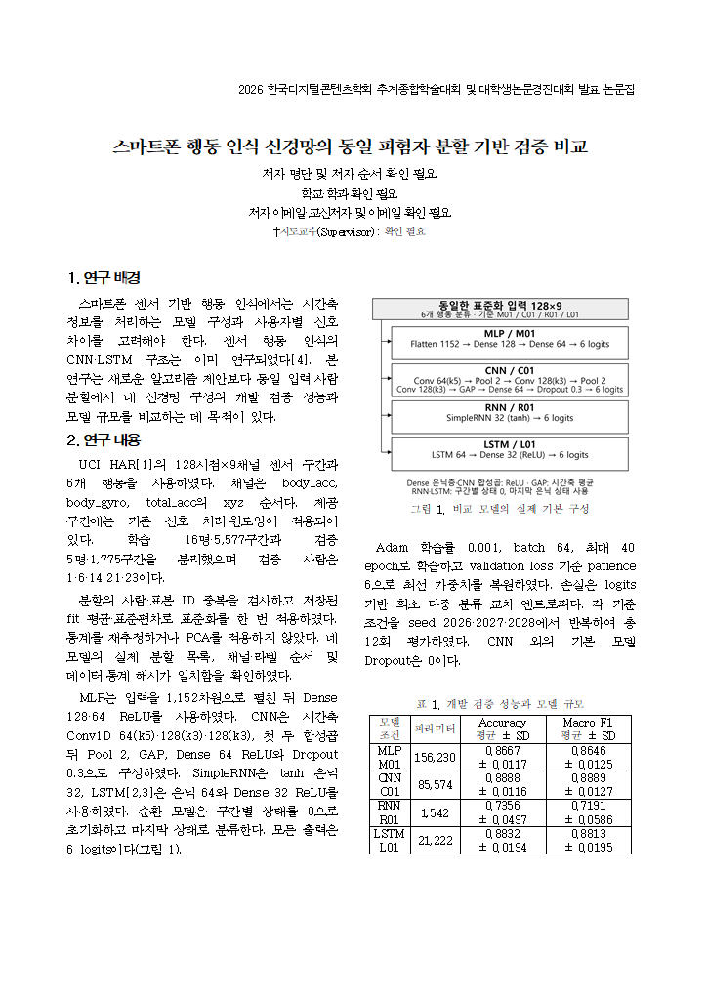
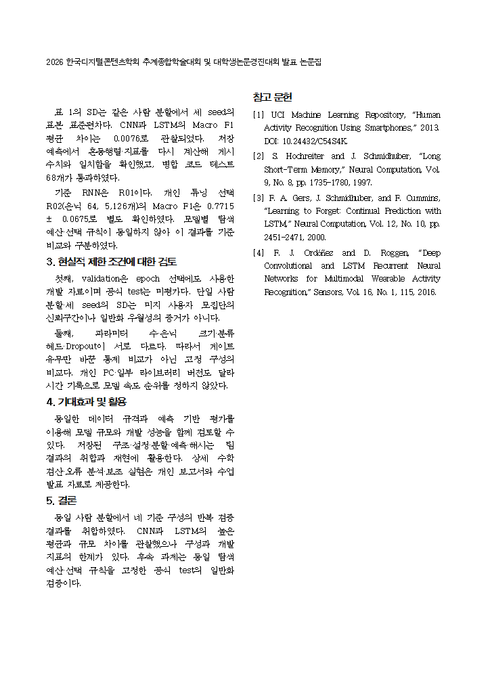

# 대학생 공식 양식의 네 모델 공동 논문 HWP

2026년 10월 13일. 사용자가 첨부한 **[양식] DCS_2026_추계종합학술대회_대학생논문경진대회_논문_Form(대학생).hwp**의 페이지·여백·글꼴·제목 및 저자란·본문 서식을 사용해 네 모델 통합 원고를 만들었다. 실제 한글 파일로 저장하고 다시 불러와 **총 2쪽**을 확인했다. 학회에는 제출하지 않았다.

## 사용할 파일

- **DCS_2026_대학생_네모델_통합초안.hwp**: 실제로 편집할 네 모델 통합 한글 초안. 일반 논문 양식이 아닌 대학생 양식이다.
- **DCS_TEAM_PAPER_KO.md**: HWP와 같은 제목·본문·수치·참고문헌을 담은 수정용 원고.
- **figures/model_architectures.png·svg**: 실제 M01·C01·R01·L01 구조. HWP에는 폭 약 80 mm로 삽입했다.
- **previews/page1.png·page2.png**: 검토한 한글 페이지 미리보기.
- **VERIFICATION.json**: 첨부 양식 해시, 2쪽·재로딩·서식·수치·본문·이미지·배치 검증 기록.
- **SUBMISSION_CHECKLIST_KO.md**: 저자 정보와 최종 대표·원고 내용 확인 사항.
- **SHA256SUMS.txt**: 배포 파일 해시.

## 양식에 적용한 사항

1. 원본의 제목·저자 영역과 본문 2단, 종이 크기·여백을 보존했다. 본문은 휴먼명조 10 pt, 양쪽 정렬이며 원본 들여쓰기·160% 줄 간격을 사용했다.
2. 장은 **연구 배경 → 연구 내용 → 현실적 제한 조건에 대한 검토 → 기대효과 및 활용 → 결론 → 참고 문헌** 순서다.
3. 네 모델 공통 구조 그림 1개와 비교표 1개를 넣고 앞뒤 빈 문단을 유지했다. 두 개체는 ‘글자처럼 취급’이며 제목은 휴먼명조 9 pt 중앙 정렬의 일반 문단이다. 한글의 ‘캡션 넣기’ 기능으로 제목을 만들지 않았다.
4. 그림·표·참고문헌을 포함해 2쪽이다. 꼬리말 페이지 번호가 없고 양식의 예시 이름·학교·본문·감사 문구·작성 지침은 원고에서 제거했다.
5. 두 쪽의 한글 미리보기를 검토했다. 두 번째 쪽은 같은 여백·2단·짝수 쪽 머리말을 사용한 임시 한글 렌더링과 원본 문서의 본문 15개 문단 배치 좌표가 정확히 일치하는지 대조했다.

수치를 줄여 넣기 위해 글꼴을 임의로 축소하지 않았다. 결과표의 Accuracy와 Macro F1은 둘 다 0~1 비율의 평균 ± seed 표본 SD다. 수치는 `reports/team_comparison/baseline_summary.csv`에서 가져왔다.

## 아직 확정하지 않은 내용

저자 명단·순서·학교·학과·이메일·교신저자·지도교수는 사용자 답변에 따라 **‘확인 필요’**로 남겼다. 현재 비교표와 그림의 RNN은 R01이며, 담당자가 개인 튜닝으로 선택한 R02의 결과는 본문에 별도 명시했다. 최종 대표 조건과 데이터 설명을 팀·지도교수와 검토한 뒤 확정한다. 공식 test는 미평가이며 원고도 개발 validation 연구로 작성했다.

현재 파일은 **양식과 2쪽 배치를 검증한 공동 초안**이다. 저자란이나 본문·표를 변경하면 페이지 수와 두 쪽 배치를 다시 확인해야 한다. 학회가 사용자에게 보낸 안내대로 제출 파일은 HWP이며 PDF가 아니다.

[GitHub Release 다운로드](https://github.com/kara320090/smartphone-har/releases/tag/bongheon-team-student-hwp-v1) · [네 모델 비교·예측 재계산 근거](https://github.com/kara320090/smartphone-har/tree/main/reports/team_comparison) · [상세 통합 검토](https://github.com/kara320090/smartphone-har/blob/main/docs/team-paper/integrated-20261013/README.md)

## 페이지 미리보기

