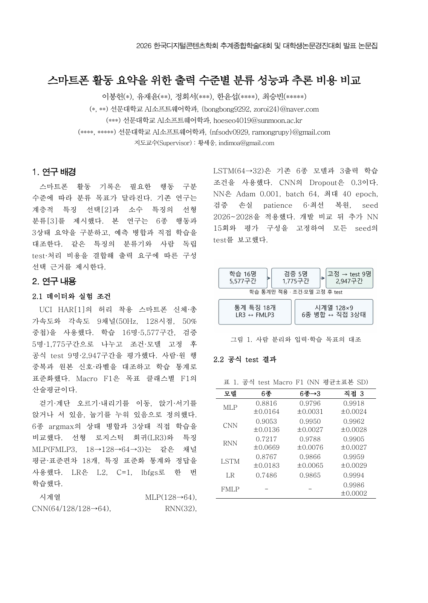

# 논문 v10.2 · 지도교수 피드백 반영

- `DCS_2026_대학생_논문개정_v10_2.hwp`: 대학생 공식 양식의 2페이지 한글 원고
- `DCS_2026_대학생_논문개정_v10_2.pdf`: 검토용 PDF
- [본문 Markdown](DCS_TEAM_PAPER_KO.md)
- [피드백 반영표와 회신 문안](FEEDBACK_RESPONSE_KO.md)
- [동일 기준의 PPT·대본·38문항](../dcs-conference-presentation-v10-2/README.md)

황세웅 지도교수 이메일, CPU·GPU 모델명과 버전을 추가했다. 공식 양식에 Abstract 항목이 없는 것을 확인하고 2페이지를 유지했다. 학교 사사 문서의 국·영문 번호는 모두 2024-0-00023으로 일치했다.

직접 3상태의 구성별 대표 F1은 0.9905~0.9994이다. 결론은 필요한 행동 정보를 먼저 정한 뒤 높은 성능을 보인 구성의 처리 비용을 비교하는 방향으로 정리했다. 신경망은 seed 평균, LR은 단일 적합이다. 동일 특징 LR3·FMLP3의 PC 처리 시간은 약 14.2배 차이이며, 이 결과를 통계적 성능 동등성이나 스마트폰의 속도로 확대하지 않는다.

고정 실험과 공식 test 수치는 v10·v10.1에서 그대로 이어진다. [모델·원자료 Release](https://github.com/kara320090/smartphone-har/releases/tag/bongheon-team-research-paper-v10)를 통해 재현 근거를 확인할 수 있다.

