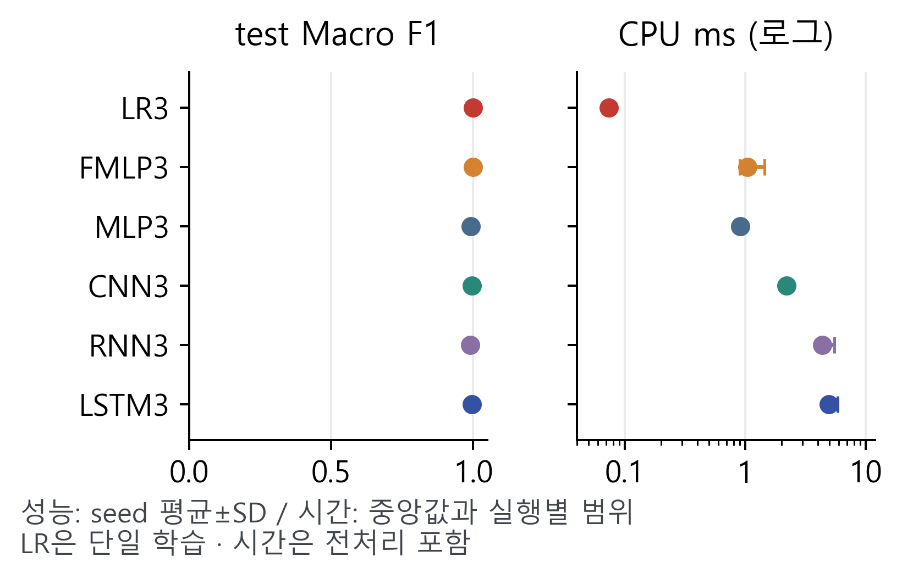

# 스마트폰 센서 기반 활동 요약을 위한 분류 목표와 모델 구성 비교

> v10.3 · 2026-10-23 제목 통일. 연구 본문과 고정 실험·공식 test 수치는 v10.2와 동일.

이봉헌(\*), 유재윤(\*\*), 정회서(\*\*\*), 한윤섭(\*\*\*\*), 최승빈(\*\*\*\*\*)
(\*, \*\*) 선문대학교 AI소프트웨어학과, {bongbong9292, zoroi24}@naver.com
(\*\*\*) 선문대학교 AI소프트웨어학과, hoeseo4019@sunmoon.ac.kr
(\*\*\*\*, \*\*\*\*\*) 선문대학교 AI소프트웨어학과, {nfsodv0929, ramongrupy}@gmail.com
지도교수(Supervisor) : 황세웅, indimoa@gmail.com

## 1. 연구 배경

스마트폰 활동 기록은 필요한 행동 구분 수준에 따라 분류 목표가 달라진다. 기존 연구는 계층적 특징 선택[2]과 소수 특징의 선형 분류[3]를 제시했다. 본 연구는 6종 행동과 3상태 요약을 구분하고, 예측 병합과 직접 학습을 대조한다. 같은 특징의 분류기와 사람 독립 test·처리 비용을 결합해 출력 요구에 따른 구성 선택 근거를 제시한다.

## 2. 연구 내용

2.1 데이터와 실험 조건

UCI HAR[1]의 허리 착용 스마트폰 신체·총 가속도와 각속도 9채널(50Hz, 128시점, 50% 중첩)을 사용했다. 학습 16명·5,577구간, 검증 5명·1,775구간으로 나누고 조건·모델 고정 후 공식 test 9명·2,947구간을 평가했다. 사람·원 행 중복과 원본 신호·라벨을 대조하고 학습 통계로 표준화했다. Macro F1은 목표 클래스별 F1의 산술평균이다.

걷기·계단 오르기·내리기를 이동, 앉기·서기를 앉거나 서 있음, 눕기를 누워 있음으로 정의했다. 6종 argmax의 상태 병합과 3상태 직접 학습을 비교했다. 선형 로지스틱 회귀(LR3)와 특징 MLP(FMLP3, 18→128→64→3)는 같은 채널 평균·표준편차 18개, 특징 표준화 통계와 정답을 사용했다. LR은 L2, C=1, lbfgs로 한 번 학습했다.

시계열 MLP(128→64), CNN(64/128/128→64), RNN(32), LSTM(64→32)은 기존 6종 모델과 3출력 학습 조건을 사용했다. CNN의 Dropout은 0.3이다. NN은 Adam 0.001, batch 64, 최대 40 epoch, 검증 손실 patience 6·최선 복원, seed 2026~2028을 적용했다. 개발 비교 뒤 추가 NN 15회와 평가 구성을 고정하여 모든 seed의 test를 보고했다.

그림 1. 사람 분리와 입력·학습 목표의 대조

2.2 공식 test 결과

표 1. 공식 test Macro F1 (NN 평균±표본 SD)

| 모델 | 6종 | 6종→3 | 직접 3 |
| --- | --- | --- | --- |
| MLP | 0.8816 ±0.0164 | 0.9796 ±0.0031 | 0.9918 ±0.0024 |
| CNN | 0.9053 ±0.0136 | 0.9950 ±0.0027 | 0.9962 ±0.0028 |
| RNN | 0.7217 ±0.0669 | 0.9788 ±0.0076 | 0.9905 ±0.0027 |
| LSTM | 0.8767 ±0.0183 | 0.9866 ±0.0065 | 0.9959 ±0.0029 |
| LR | 0.7486 | 0.9865 | 0.9994 |
| FMLP | - | - | 0.9986 ±0.0002 |

6종 F1은 CNN 0.9053, LR6 0.7486이었다. 직접 3상태는 모든 구성에서 0.9905~0.9994로 높았다. 네 NN은 병합보다 평균 F1이 높고 같은 seed 12쌍 중 11쌍에서 증가했다(LSTM 2027: -0.0011). 동일 특징의 LR3·FMLP3는 0.9994·0.9986이었다. LR3 오류 2구간은 사람 9의 앉기를 이동으로 예측한 경우다. NN은 평균±표본 SD, LR은 단일 학습이다.

2.3 준비된 센서 구간의 처리 비용

공통 평가는 Intel Core i9-13980HX CPU(연산 4·상호 1스레드), Python 3.11.9, TensorFlow 2.21.0, Keras 3.15.1, NumPy 2.2.6을 사용했다. LR 학습은 scikit-learn 1.7.2이다. 탑재 GPU는 RTX 4060 Laptop이며 평가에는 사용하지 않았다. 검증 첫 구간을 batch 1, 워밍업 50회 후 500회 측정했다. 전처리·특징·분류·반환 시간은 LR3 0.073ms, FMLP3 1.043ms였다. 각 실행 중앙값의 중앙값이며 수집·필터링·구간화·초기 로딩은 제외했다.

그림 2. 3상태 성능과 CPU 처리 비용

## 3. 평가 범위와 결과 해석

3상태 F1이 높은 구간에 밀집해 작은 점수 차이를 모델 우월성으로 해석하지 않는다. 동일 특징 LR3·FMLP3의 파라미터는 57·10,883개, 처리 시간은 약 14.2배 차이였다. 이는 고정 구성의 관측 비용이며 통계적 성능 동등성이나 스마트폰 성능을 뜻하지 않는다. 평가 범위는 허리 착용 6동작이고, seed SD는 고정 test의 학습 변동이다.

## 4. 기대효과 및 활용

카메라·GPS 없이 구간별 이동·앉거나 서 있음·누워 있음 태그를 부여하는 활동 요약에 연결한다. 이 목표에서는 높은 분류 성능을 보인 단순 구성의 비용을 검토할 근거가 있다. 좌식 시간이나 계단 이용 기록은 앉기·서기와 이동 세부 라벨을 유지해 6종 지표로 선택한다. 누워 있음은 자세 라벨이다.

## 5. 결론

직접 3상태는 모든 구성에서 높은 F1을 보였으나 처리 비용은 달랐다. 6종에서는 CNN 0.9053과 LR6 0.7486으로 결과가 달라졌다. 본 연구는 보존할 행동 정보를 먼저 정하고, 해당 목표에서 높은 성능을 보인 구성의 비용을 비교하는 선택 근거를 제시했다.

## 참고 문헌

[1] J. L. Reyes-Ortiz et al., “Human Activity Recognition Using Smartphones,” UCI, 2013. DOI: 10.24432/C54S4K.

[2] A. Wang et al., “Towards Human Activity Recognition: A Hierarchical Feature Selection Framework,” Sensors, 18(11), 3629, 2018.

[3] I. Debache et al., “A Lean and Performant Hierarchical Model for Human Activity Recognition Using Body-Mounted Sensors,” Sensors, 20(11), 3090, 2020.

github.com/kara320090/smartphone-har

## 감사의 글

본 연구는 2026년도 과학기술정보통신부 및 정보통신기획평가원의 ‘SW중심대학지원사업’의 연구 결과로 수행되었습니다(2024-0-00023).
