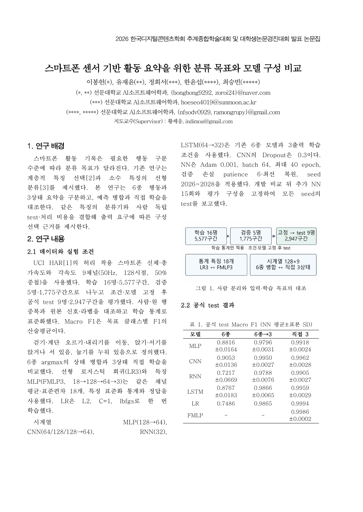
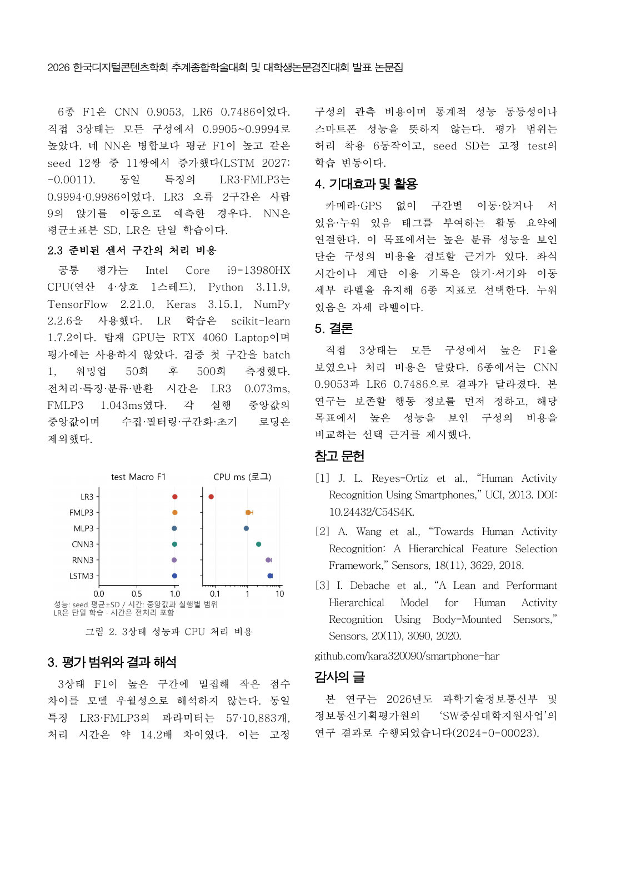

# 논문 v10.3 · 제목 통일

**스마트폰 센서 기반 활동 요약을 위한 분류 목표와 모델 구성 비교**

2026-10-23 확정 제목을 논문·포스터 발표 대본·PPT 표지와 발표자 노트에 동일하게 적용했다.

- `DCS_2026_대학생_논문개정_v10_3.hwp`: 제출용 2페이지 한글 원고
- `DCS_2026_대학생_논문개정_v10_3.pdf`: 검토용 PDF
- [본문 Markdown](DCS_TEAM_PAPER_KO.md)
- [포스터 발표 대본·PPT·예상 질문](../dcs-conference-presentation-v10-3/README.md)

연구 본문·수치·그림·저자 정보·지도교수 이메일·사사 문구는 v10.2와 같다. 제목의 ‘분류 목표’는 6종 행동과 3상태 요약, ‘모델 구성’은 시계열 신경망과 통계 특징 기반 분류기의 비교를 뜻한다.

[교수 피드백 반영 기록](../dcs-team-paper-research-v10-2/FEEDBACK_RESPONSE_KO.md) · [모델·실험 근거](https://github.com/kara320090/smartphone-har/releases/tag/bongheon-team-research-paper-v10)

