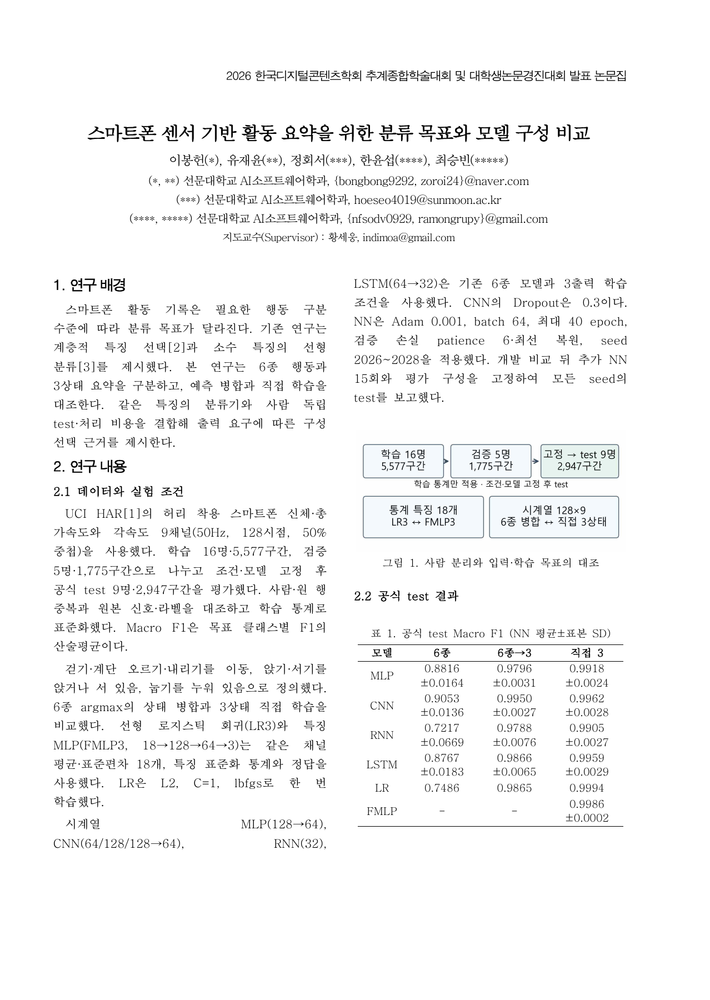
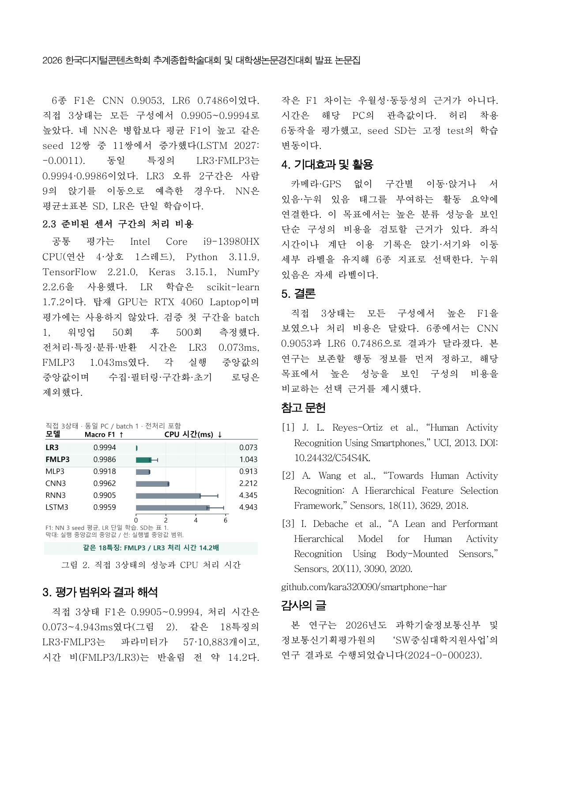

# 논문 v10.4 · 그림의 판단 가능성 보완

**스마트폰 센서 기반 활동 요약을 위한 분류 목표와 모델 구성 비교**

그림 2를 수치와 선형 시간 막대로 다시 구성했다. 작은 F1 차이를 점의 간격으로 판단하게 하지 않고, 각 구성의 정확한 점수와 구현 비용을 읽을 수 있도록 했다. 동일 18특징 LR3·FMLP3의 비용 비를 강조하고 캡션·해석을 연결했다.

- `DCS_2026_대학생_논문개정_v10_4.hwp`: 공식 대학생 양식 2페이지 한글 원고
- `DCS_2026_대학생_논문개정_v10_4.pdf`: 동일 내용 2페이지 PDF
- [본문 Markdown](DCS_TEAM_PAPER_KO.md)
- [그림 개정 이유와 판단 근거](FIGURE_REVISION_KO.md)
- [그림 수치와 원자료 해시](figures/FIGURE_DATA.json)
- [그림 재생성 코드](figures/regenerate_figure.py)

고정 실험·공식 test 수치, 제목, 저자, 지도교수 이메일과 사사는 v10.3과 동일하다. [v10.3 원고](../dcs-team-paper-research-v10-3/README.md)와 [실제 포스터 v10.3-r1](../dcs-poster-v10-3/README.md)은 보존한다. 학회 안내에 따른 투고 파일 형식은 HWP이며 PDF는 열람·검토용이다.

