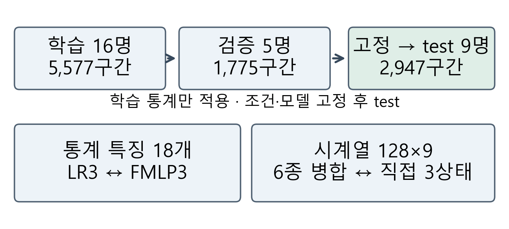
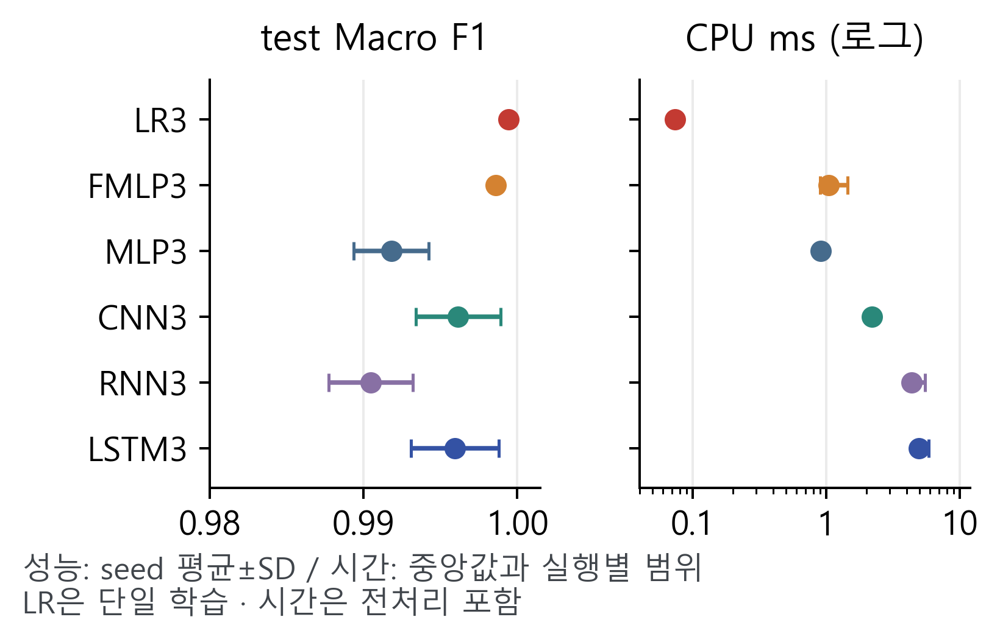

# 스마트폰 활동 요약을 위한 출력 수준별 분류 성능과 추론 비용 비교

> v10 · 개발 조건 고정 후 공식 test 평가 반영. 학회 제출 전 공동저자 검토용.

이봉헌(\*), 유재윤(\*\*), 정회서(\*\*\*), 한윤섭(\*\*\*\*), 최승빈(\*\*\*\*\*)
(\*, \*\*) 선문대학교 AI소프트웨어학과, {bongbong9292, zoroi24}@naver.com
(\*\*\*) 선문대학교 AI소프트웨어학과, hoeseo4019@sunmoon.ac.kr
(\*\*\*\*, \*\*\*\*\*) 선문대학교 AI소프트웨어학과, {nfsodv0929, ramongrupy}@gmail.com
지도교수(Supervisor) : 황세웅

## 1. 연구 배경

스마트폰 센서 기반 활동 기록은 서비스 목적에 따라 필요한 행동 구분 수준이 다르다. 기존 연구는 계층적 특징 선택[2]과 소수 특징의 선형 분류[3]를 제안했다. 본 연구는 세부 행동 대신 큰 상태를 기록할 때 필요한 분류 구성을 살펴보고, 같은 입력·목표의 대조와 독립 test 및 CPU 비용 측정으로 모델 선택 근거를 제시한다.

## 2. 연구 내용

2.1 데이터와 실험 조건

UCI HAR[1]의 허리 착용 스마트폰 신체·총 가속도와 각속도 xyz(9채널, 50Hz, 128시점, 50% 중첩)를 사용했다. 공식 train을 학습 16명·5,577구간과 검증 5명·1,775구간으로 나눴다. 조건·모델 고정 후 공식 test 9명·2,947구간을 평가했다. 사람·원 행의 중복을 배제하고 원본 센서·라벨과 캐시를 대조했다. 모든 표준화 통계는 학습 자료에서 산출했다.

걷기·계단 오르기·내리기를 이동, 앉기·서기를 앉거나 서 있음, 눕기를 누워 있음으로 묶었다. 6종 argmax를 병합하는 방식과 3상태 직접 학습을 비교했다. 채널 평균·표준편차 18개를 공유하는 LR3와 FMLP3(128→64)를 추가해 입력·목표를 맞췄다. LR은 L2, C=1, lbfgs로 한 번 학습했다.

시계열 MLP(128→64), CNN(64/128/128→64), RNN(32), LSTM(64→32)은 기존 6종 모델과 출력층을 3개로 바꾼 조건을 사용했다. CNN만 Dropout 0.3을 적용했다. NN은 Adam 0.001, batch 64, 최대 40 epoch, 검증 손실 patience 6·최선 복원, seed 2026~2028을 적용했다. 추가 NN 15회 후 구성을 고정했으며 test를 보고 재학습하지 않았다.

그림 1. 사람 분리와 입력·학습 목표의 대조

2.2 공식 test 결과

표 1. 공식 test Macro F1 (평균±seed SD)

| 모델 | 6종 | 6종→3 | 직접 3 |
| --- | --- | --- | --- |
| MLP | 0.8816 ±0.0164 | 0.9796 ±0.0031 | 0.9918 ±0.0024 |
| CNN | 0.9053 ±0.0136 | 0.9950 ±0.0027 | 0.9962 ±0.0028 |
| RNN | 0.7217 ±0.0669 | 0.9788 ±0.0076 | 0.9905 ±0.0027 |
| LSTM | 0.8767 ±0.0183 | 0.9866 ±0.0065 | 0.9959 ±0.0029 |
| LR | 0.7486 | 0.9865 | 0.9994 |
| FMLP | - | - | 0.9986 ±0.0002 |

6종 F1은 CNN 0.9053, LR6 0.7486이었다. 네 NN 모두 직접 3상태의 평균 F1이 6종 예측 병합보다 높았다. LR3와 FMLP3의 직접 3상태 F1은 각각 0.9994, 0.9986이었다. LR3의 test 오류는 2/2,947개였다. 두 구성의 파라미터는 57개와 10,883개다. LR은 단일 학습, NN은 세 seed 평균±표본 SD다. 요약 점수는 6종 분류의 개선이나 통계적 동등성의 증거가 아니다.

2.3 준비된 센서 구간의 처리 비용

동일 CPU·4스레드, batch 1에서 50회 워밍업 후 500회 측정했다. 표준화·특징 계산·모델 호출·확률과 클래스 반환을 포함한 중앙값은 LR3 0.073ms, FMLP3 1.043ms였다(그림 2). 수집·필터링·구간화·초기 로딩은 제외했다. 시간은 각 실행 중앙값의 중앙값이다.

그림 2. 직접 3상태의 test 성능과 CPU 처리 비용

## 3. 현실적 제한 조건에 대한 검토

추가 조건은 개발 결과를 본 뒤 설계했다. 공식 test도 한 데이터셋의 9명이므로 휴대 위치·기기·전환 동작의 일반화는 남아 있다. seed SD는 사람 모집단 신뢰구간이 아니다. LR과 시계열 NN은 입력 표현이 다르며, NumPy와 TensorFlow의 시간 차이에는 런타임도 포함된다. 스마트폰 전력·실시간 동작은 미검증이다.

## 4. 기대효과 및 활용

카메라·GPS 없이 이동·자세 상태를 표시하는 활동 기록 모듈의 후보를 비교했다. 큰 상태 기록은 통계 특징·선형 기준선부터 확인하고, 계단·앉기 등 세부 기록은 해당 과제의 오류와 비용으로 구성을 선택할 수 있다. 눕기는 수면이 아니며 앱·일별 지속시간은 구현하지 않았다.

## 5. 결론

공식 test에서 18개 통계 특징의 선형 모델은 3상태 F1 0.9994와 CPU 0.073ms를 보였다. 요약 기록은 3상태 직접 학습과 통계·선형 기준선을 우선 검토하고, 세부 기록은 6종 성능으로 판단하는 설계 절차를 제안한다. 기기별 연속 신호에서 후속 검증이 필요하다.

## 참고 문헌

[1] J. L. Reyes-Ortiz et al., “Human Activity Recognition Using Smartphones,” UCI, 2013. DOI: 10.24432/C54S4K.

[2] A. Wang et al., “Towards Human Activity Recognition: A Hierarchical Feature Selection Framework,” Sensors, 18(11), 3629, 2018.

[3] I. Debache et al., “A Lean and Performant Hierarchical Model for Human Activity Recognition Using Body-Mounted Sensors,” Sensors, 20(11), 3090, 2020.

github.com/kara320090/smartphone-har

## 감사의 글

본 연구는 2026년도 과학기술정보통신부 및 정보통신기획평가원의 ‘SW중심대학지원사업’의 연구 결과로 수행되었습니다(2024-0-00023).
