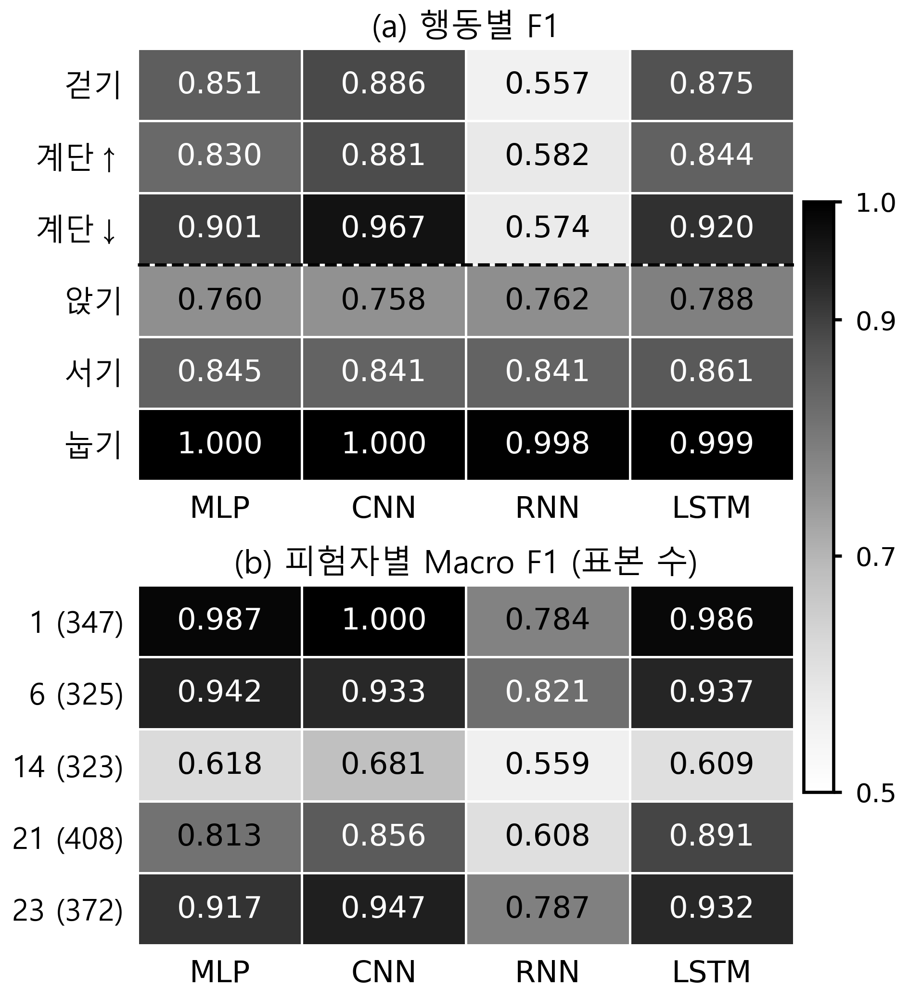

# 스마트폰 행동 인식 신경망의 모델 규모와 행동·피험자별 오류 비교

저자 명단 및 저자 순서 확인 필요
학교·학과 확인 필요
저자 이메일·교신저자 및 이메일 확인 필요
†지도교수(Supervisor) : 확인 필요

## 1. 연구 배경

스마트폰 센서 기반 행동 인식의 공개 데이터 연구[1]와 CNN·LSTM 연구[4]가 축적되어 있으나 전체 점수만으로 행동·사용자별 오류를 파악하기는 어렵다. 본 연구는 네 고정 신경망 구성의 기존 반복 실험을 재분석하여 두 질문을 다룬다. 모델 규모와 평균 검증 성능은 어떻게 다른가? 전체 순위가 행동군과 피험자별 성능에도 일관되는가? 새로운 알고리즘이나 최고 성능을 주장하지 않고, 동일 분할에서 규모와 오류 위치를 함께 보고한다.

## 2. 연구 내용

UCI HAR[1,2]의 6개 행동, 50 Hz·128시점(2.56초)×9채널 센서 구간을 사용하였다. 채널은 body_acc·body_gyro·total_acc의 xyz 순서이며 제공 신호에는 필터링·50% 중첩 윈도잉이 적용되어 있다. 공식 학습 자료에서 학습 16명·5,577구간과 검증 5명·1,775구간(피험자 1·6·14·21·23)을 분리하였다.

사람·표본 ID 중복이 없고 네 모델의 분할·ID·정답 순서·데이터 해시가 일치함을 검사하였다. fit에서 계산해 저장한 평균·표준편차로 한 번 표준화했으며 PCA는 적용하지 않았다. 평가에는 클래스별 F1을 균등 평균한 Macro F1과 Accuracy를 사용한다.

MLP는 Flatten→Dense 128·64 ReLU, CNN은 Conv1D 64(k5)·128(k3)·128(k3)→GAP→Dense 64 ReLU이며 첫 두 합성곱 뒤 Pool 2를 둔다. SimpleRNN은 tanh 은닉 32, LSTM[3]은 은닉 64→Dense 32 ReLU다. 순환 모델은 구간별 초기 상태를 0으로 두고 마지막 상태를 사용한다. 출력은 6 logits, CNN의 Dense 뒤 Dropout만 0.3이며 나머지 기본 조건은 0이다.

Adam 0.001, batch 64, 최대 40 epoch, logits 기반 희소 교차 엔트로피와 validation loss 기준 early stopping(patience 6, 최선 가중치 복원)을 사용하였다. 각 기준 조건을 seed 2026·2027·2028에서 반복한 12회 저장 예측으로 지표를 재계산하였다. RNN은 기준 R01, LSTM은 사전에 고정한 L01이며 개인 튜닝 결과로 교체하지 않았다.

표 1. 개발 검증 성능과 모델 규모

| 모델 | 조건 | 파라미터 | Accuracy 평균 ± SD | Macro F1 평균 ± SD |
| --- | --- | ---: | ---: | ---: |
| MLP | M01 | 156,230 | 0.8667 ± 0.0117 | 0.8646 ± 0.0125 |
| CNN | C01 | 85,574 | 0.8888 ± 0.0116 | 0.8889 ± 0.0127 |
| RNN | R01 | 1,542 | 0.7356 ± 0.0497 | 0.7191 ± 0.0586 |
| LSTM | L01 | 21,222 | 0.8832 ± 0.0194 | 0.8813 ± 0.0195 |

표 1의 SD는 고정 사람 분할에서 세 seed의 표본 표준편차다. LSTM은 CNN보다 파라미터가 75.2% 적고 Macro F1 평균은 0.0076 낮았다. 이는 개발 성능과 규모의 절충을 보여주며 속도·전력이나 통계적 동등성을 뜻하지 않는다.

그림 1. 행동별·피험자별 F1의 세 seed 평균

그림 1(a)의 점선 위는 동적 행동, 아래는 정적 자세다. 전체 6클래스 혼동행렬에서 구한 각 군의 세 클래스 F1 평균은 CNN이 동적 0.9115·정적 0.8662, LSTM이 0.8798·0.8828이다. RNN의 동적 평균은 0.5711, 정적 평균은 0.8671로 낮은 전체 점수가 정적 자세 전반의 실패를 뜻하지 않았다.

앉기→서기 오류율은 실제 앉기 309구간을 분모로 seed별 계산 후 평균했을 때 MLP 38.6%, CNN 36.9%, RNN 36.8%, LSTM 31.3%였다(LSTM SD 19.6%p). 이는 기존 연구[1]의 자세 혼동과 부합하는 관찰이다. 그림 1(b)는 피험자 내부 6클래스 Macro F1이다. 피험자 14(323구간)는 네 구성 모두 최저(0.5593–0.6812)였고 LSTM은 전체 0.8813에 비해 이 피험자에서 0.6089였다.

## 3. 현실적 제한 조건에 대한 검토

첫째, validation은 epoch 선택에도 사용한 개발 자료이고 오류 분석은 사후 분석이다. 공식 test는 미평가이며 단일 사람 분할·세 seed의 SD는 사용자 모집단의 신뢰구간이 아니다.

둘째, 모델 용량·헤드·Dropout과 탐색 예산이 달라 게이트나 합성곱만의 효과를 분리하지 못한다. 행동·피험자별 차이의 원인은 측정하지 않았다. 서로 다른 PC의 시간으로 속도 순위를 정하지 않았다.

## 4. 기대효과 및 활용

규모와 오류 위치를 함께 제시해 모델 선정과 취약 피험자 검토에 활용할 수 있다. 저장 예측·설정·해시와 클래스·피험자별 표를 재현 근거로 제공한다.

## 5. 결론

네 구성의 개발 검증에서 성능·규모의 절충과 행동군별 순위 차이, 공통 취약 피험자를 관찰하였다. 후속 과제는 선택 규칙과 탐색 예산을 고정한 공식 test의 일반화 검증이다.

## 참고 문헌

[1] D. Anguita et al., “A Public Domain Dataset for Human Activity Recognition Using Smartphones,” ESANN, pp. 437–442, 2013.

[2] J. L. Reyes-Ortiz et al., “Human Activity Recognition Using Smartphones,” UCI Machine Learning Repository, 2013. DOI: 10.24432/C54S4K.

[3] S. Hochreiter and J. Schmidhuber, “Long Short-Term Memory,” Neural Computation, Vol. 9, No. 8, pp. 1735–1780, 1997.

[4] F. J. Ordóñez and D. Roggen, “Deep Convolutional and LSTM Recurrent Neural Networks for Multimodal Wearable Activity Recognition,” Sensors, Vol. 16, No. 1, 115, 2016.
