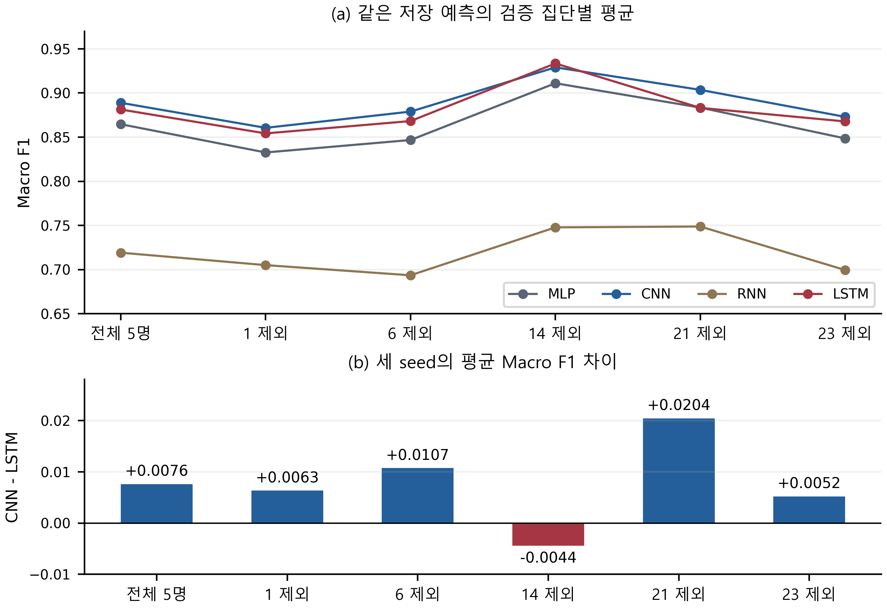

# 다른 대학 논문과의 비교를 반영한 연구 보강 v4

2026-10-14 · 제목: **스마트폰 행동 인식 신경망의 성능·규모 절충과 피험자별 편차 분석**

## 무엇을 기준으로 수준을 높였는가

학교 이름이나 최고 점수로 연구 수준을 정하지 않았다. 같은 학술대회 관련 원고의 문제 설정·통제 조건·반복 변동·결과 해석을 비교하고, 사용자 일반화와 평가 조건을 다룬 대학 연구를 추가로 확인했다. 그 기준에서 기존 원고의 근거를 보강했다. 이는 자체 편집·연구 점검이며 공식 수상 배점 또는 학교 간 수준 순위가 아니다.

| 확인한 대학·논문 | 구체적으로 참고한 논증 | 이번 v4의 대응 |
| --- | --- | --- |
| 인하대학교: N-BEATS에 Time-o1 하이브리드 손실 함수를 적용한 금융 시계열 예측 성능 및 재현성 비교 분석 | 고정 백본의 손실 조건이라는 좁은 질문, 다섯 seed의 평균·변동 해석 | 새 모델 제안인 것처럼 쓰지 않고 고정 네 구성에서 성능·규모 및 평균 순위의 조건 의존성을 묻는다. 세 seed의 SD와 한계를 유지한다. |
| 중앙대학교: HMD 센서 데이터 기반 머리 움직임 분류를 통한 XR 인터랙션 입력 방식 설계 | 센서 분류를 구체적 입력 서비스와 연결하고 특정 동작 혼동을 해석 | 단순 구현 목록 대신 실제 행동·피험자별 지표에서 모델 선정에 필요한 정보를 제시한다. 공개 데이터 사용을 자체 센서 수집으로 바꾸어 주장하지 않는다. |
| 서울여자대학교: 앙상블 머신러닝 기반 스쿼트 자세 유형 분류 | 비교 조건·설정을 공개하고 어려운 자세를 결과와 연결 | 네 대표 구성의 조건과 파라미터를 밝히고 행동군·피험자의 성능 저하를 함께 보인다. |
| 서울여자대학교: 머신러닝 기반 신용카드 이상거래 탐지 모델 성능 비교 및 해석 가능성 분석 | 문제에 맞는 지표와 불리한 결과를 함께 해석 | Macro F1의 의미를 명시하고 취약 피험자를 대표 결과에서 삭제하지 않는다. 유리한 진단만 선택하지 않는다. |
| University College Cork: Scheurer 등, Sensors 2020 | 사용자 의존·독립 평가와 모델 개인화의 차이를 여러 데이터에서 검토 | 우리의 학습·검증 사용자 비중복과 개발 평가를 구분하고, 검증 집단 구성이 평균 순위에 관련되는지 추가 진단한다. 다중 데이터·통계 모형을 재현한 것으로 표현하지 않는다. |

국내 사례의 소속은 원고 첫 페이지에서 확인했다. 해당 논문집의 인쇄/PDF 쪽은 기존 `PROCEEDINGS_REVIEW_KO.md`와 `SOURCE_INDEX.json`에 남겨 있다. 본문·그림을 복사하거나 각 논문을 수상작으로 확인한 것은 아니다. 데이터·분할·평가지표가 다른 논문의 수치와 직접 경쟁하지 않는다.

[Cork 대학 연구의 원문·소속·방법](https://www.mdpi.com/1424-8220/20/13/3647) · [모델 구성·탐색 조건을 다룬 Newcastle 대학 연구](https://arxiv.org/abs/1604.08880)

## 이번에 추가한 근거

기존 예측 21,300행에서 **검증 피험자를 한 명씩 제외하는 다섯 경우를 모두** 계산했다. 학습 가중치·epoch·대표 구성·예측은 변경하지 않았다. 4모델×3seed×(전체 1조건+제외 5조건)의 **72개 지표**를 혼동행렬로 재계산하고 scikit-learn 구현과 대조했다. 전체 5명의 결과는 이전 감사 결과와 1e-12 이내로 일치한다.

RQ1: 어떤 성능·파라미터 절충이 관찰되는가?

RQ2: 전체 평균 순위는 행동군과 검증 피험자 구성이 달라져도 유지되는가?

첫 질문은 기존 CNN-LSTM F1 차이 0.0076과 LSTM 파라미터 75.2% 감소로 설명한다. 둘째 질문은 행동군 평균 순위와 아래 집단 구성 진단을 함께 사용한다. “저성능 사용자를 제거해 모델을 개선했다”는 연구로 바꾸지 않았다.

## 진단 정의

원래 검증 집단을 V, 피험자 s의 구간을 V_s라 할 때, 각 실행의 **저장된 예측**에서 V 또는 V\V_s의 혼동행렬을 새로 집계한다. 여섯 클래스의 F1을 각각 계산해 균등 평균한다.

`F1_c = 2 TP_c / (2 TP_c + FP_c + FN_c)`

`Macro F1 = (F1_0 + ... + F1_5) / 6`

분모가 0이면 해당 클래스의 F1을 0으로 정의한다. 실제 모든 진단 집단에는 여섯 정답 클래스가 남아 있음을 확인했다. 지표를 seed마다 계산한 뒤 평균·표본 SD를 보고한다. 서로 다른 seed의 예측을 5,325개의 독립 표본으로 합치지 않는다. CNN-LSTM 차이는 같은 seed의 F1 차이를 낸 뒤 평균했다. 같은 seed가 두 구조의 초기 가중치 일치를 뜻하지 않는다.

## 다섯 경우를 모두 보고한 결과

| 검증 집단 | 매 seed 표본 수 | MLP | CNN | RNN | LSTM | CNN-LSTM |
| --- | ---: | ---: | ---: | ---: | ---: | ---: |
| 전체 5명(대표) | 1775 | 0.8646 | 0.8889 | 0.7191 | 0.8813 | +0.0076 |
| 피험자 1 제외(진단) | 1428 | 0.8326 | 0.8605 | 0.7050 | 0.8542 | +0.0063 |
| 피험자 6 제외(진단) | 1450 | 0.8467 | 0.8789 | 0.6935 | 0.8682 | +0.0107 |
| 피험자 14 제외(진단) | 1452 | 0.9110 | 0.9290 | 0.7478 | 0.9334 | -0.0044 |
| 피험자 21 제외(진단) | 1367 | 0.8834 | 0.9035 | 0.7487 | 0.8831 | +0.0204 |
| 피험자 23 제외(진단) | 1403 | 0.8485 | 0.8729 | 0.6995 | 0.8677 | +0.0052 |

위 수치는 6클래스 Macro F1의 세 seed 평균이다. 전체 5명에서는 CNN이 높다. 피험자 14 제외 진단에서는 LSTM 평균이 높아졌고, 21 제외 진단에서는 MLP-LSTM 평균 순위도 바뀐다. 나머지 제외 경우를 포함한 전체 표와 seed SD·차이는 `diagnostic_data/`에 제공한다.

판단은 제한적이다. 제외하면 피험자 구성뿐 아니라 표본 수와 클래스 비율도 달라진다. 그 결과를 피험자 한 명의 인과 효과, 단독 원인, 사용자 모집단의 일반화 또는 통계적으로 유의한 순위 역전으로 표현하지 않는다. 사후 진단이며 학습·모델 선택을 다시 수행하지 않았다. 특히 **LOSO 교차검증이 아니다**. 새로운 사람 분할로 재학습하고 별도 사용자에서 평가하는 연구는 후속 과제다.

## 원고와 발표에 반영한 변화

- 서론의 비교 목적을 성능·규모 및 순위의 조건 의존성으로 구체화했다.
- 방법에 학습을 고정한 검증 집단 구성 진단을 명시했다.
- 두 쪽 본문에는 주요 역전과 “대표 결과는 전체 5명 유지”를 함께 썼다.
- 모든 제외 경우·수식·반복 SD·진단 그림은 보충 MD와 CSV로 남겼다.
- 이전 자세 오류 분석은 별도 질의응답·근거에 보존했다. 분량을 맞추려고 실패를 지우거나 새 오류를 만들어 넣지 않았다.
- 공식 HWP 두 쪽·본문 10pt·여백·2단·기존 주 그림과 비교표를 유지했다.
- 수업용 상세 PPT는 기존 수행 기록으로 보존한다. 최신 공동 논문의 발표 설명·질의응답은 이 새 분석에 맞춰 수정한다.

## 현실적인 수준 판단

고정 네 구성의 탐색적 비교 연구로서 질문·결과·해석의 연결을 강화했다. 파라미터 절충, 행동군 차이, 피험자 편차에 **순위 민감도 진단**을 추가했으므로 단순한 모델 실행 보고서보다 분석 근거가 분명해졌다. 다만 여러 데이터·사람 분할의 독립 평가와 통제된 탐색을 수행한 선행 연구와 동일한 증거 수준을 확보한 것은 아니다. 현재 단계의 사실과 후속 과제를 분리하는 것이 심사 질문을 견딜 수 있는 표현이다.

수상 가능성을 수치로 예측하지 않는다. 더 강한 일반화 주장에는 사전에 확정한 복수 사람 분할·모델 선택·독립 평가가 필요하고, 모바일 효율 주장에는 실제 기기 측정이 필요하다. 이번 작업은 그러한 실험을 새로 수행하지 않았다.
