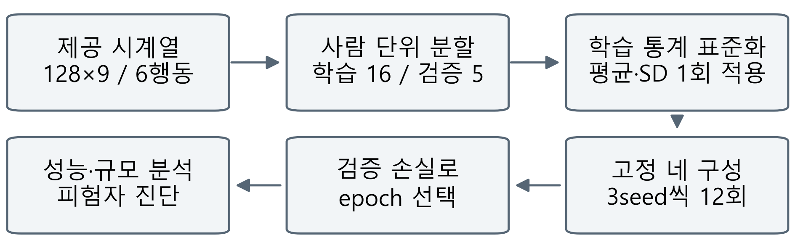
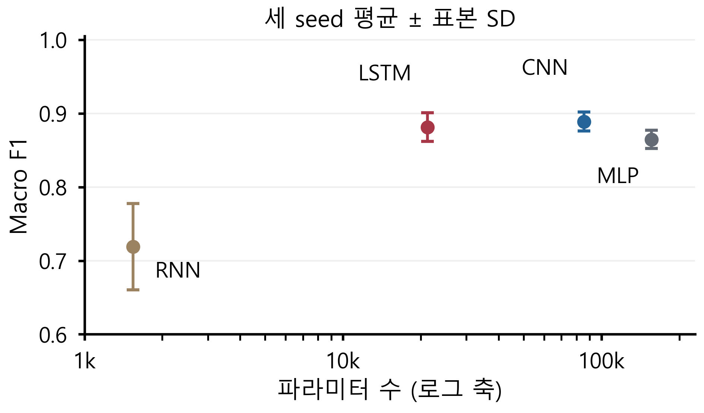
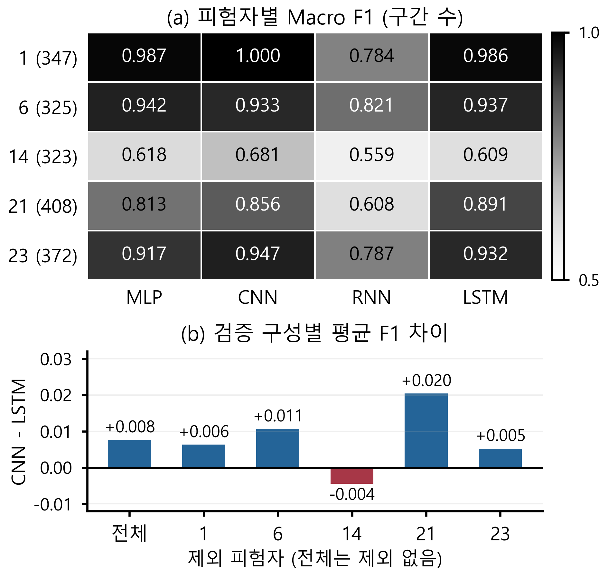

# 스마트폰 행동 인식 신경망의 성능·규모 절충과 피험자별 편차 분석

> 공개 개정 초안 v5. 개발 validation 결과이며 공식 test는 미평가다. 사사는 확인 후 확정한다.

이봉헌(\*), 유재윤(\*\*), 정회서(\*\*\*), 한윤섭(\*\*\*\*), 최승빈(\*\*\*\*\*)
(\*, \*\*) 선문대학교 AI소프트웨어학과, {bongbong9292, zoroi24}@naver.com
(\*\*\*) 선문대학교 AI소프트웨어학과, hoeseo4019@sunmoon.ac.kr
(\*\*\*\*, \*\*\*\*\*) 선문대학교 AI소프트웨어학과, {nfsodv0929, ramongrupy}@gmail.com
지도교수(Supervisor) : 황세웅

## 1. 연구 배경

스마트폰 센서 기반 행동 인식에서 평균 성능만으로 모델을 선정하면 규모·사용자별 편차를 놓칠 수 있다[1,2]. 본 연구는 동일 사람 분할의 네 신경망 구성에서 성능·규모 절충과 검증 집단에 따른 평균 순위 변화를 분석한다.

## 2. 연구 내용

UCI HAR[1]의 6행동을 50 Hz·128시점×9채널(신체 가속도·각속도·총 가속도의 xyz)로 입력했다. 제공 신호의 필터링·50% 중첩은 유지했다. 공식 학습 자료를 학습 16명·5,577구간, 검증 5명·1,775구간(1·6·14·21·23)으로 나누고 사람·표본 ID 비중복과 모델 간 정합성을 검사했다. 저장된 학습 평균·표준편차로 한 번 표준화했다.

그림 1. 공통 개발 실험과 분석 흐름

MLP는 Flatten→Dense 128·64 ReLU, CNN은 Conv1D 64(k5)·128(k3)·128(k3)→GAP→Dense 64 ReLU이며 첫 두 층 뒤 Pool 2를 둔다. SimpleRNN은 tanh 은닉 32, LSTM은 은닉 64→Dense 32 ReLU다. 순환 상태는 구간마다 0에서 시작해 마지막 상태를 사용한다. 출력은 6 logits, Dense 뒤 Dropout은 CNN 0.3, 나머지 0이다.

Adam 0.001, batch 64, 최대 40 epoch, logits 기반 희소 교차 엔트로피와 검증 손실 기준 early stopping(patience 6, 최선 복원)을 적용했다. seed 2026·2027·2028의 12회 예측에서 6클래스 Macro F1을 계산했다. 학습을 고정한 채 검증 피험자를 한 명씩 제외하는 진단도 수행했다.

표 1. 개발 검증 성능과 모델 규모

| 모델 | 조건 | 파라미터 | Accuracy 평균 ± SD | Macro F1 평균 ± SD |
| --- | --- | ---: | ---: | ---: |
| MLP | M01 | 156,230 | 0.8667 ± 0.0117 | 0.8646 ± 0.0125 |
| CNN | C01 | 85,574 | 0.8888 ± 0.0116 | 0.8889 ± 0.0127 |
| RNN | R01 | 1,542 | 0.7356 ± 0.0497 | 0.7191 ± 0.0586 |
| LSTM | L01 | 21,222 | 0.8832 ± 0.0194 | 0.8813 ± 0.0195 |

그림 2. 파라미터 수와 개발 검증 성능

표 1·그림 2에서 CNN·LSTM 평균 F1은 0.8889·0.8813(차이 0.0076)이며 LSTM 파라미터는 75.2% 적다. 오차막대는 세 seed의 표본 SD이며 신뢰구간이 아니다.

동적 세 행동·정적 세 자세의 클래스 F1 평균은 CNN 0.9115·0.8662, LSTM 0.8798·0.8828로 행동군별 평균 순위가 바뀌었다.

그림 3. 피험자별 성능과 검증 구성 민감도

그림 3(a)의 피험자별 6클래스 Macro F1에서 14(323구간)는 네 구성 모두 최저(0.5593-0.6812)였다. LSTM도 전체 0.8813에 비해 0.6089로 낮았다.

그림 3(b)는 다섯 제외 진단을 모두 나타낸다. 14 제외 시 CNN·LSTM 평균은 0.9290·0.9334로 역전됐다. 표본·클래스 구성도 변하는 사후 진단이며 재학습 교차검증·개선 점수가 아니다. 대표 결과는 전체 5명을 유지한다.

## 3. 현실적 제한 조건에 대한 검토

검증은 epoch 선택에도 사용한 개발용이며 공식 test는 미평가다. 단일 분할·세 seed의 사후 분석으로 일반화·유의성·동등성을 결론낼 수 없다. 용량·헤드·Dropout·탐색 예산이 달라 구조 효과를 분리하지 못했고 오류 원인·스마트폰 속도·전력은 미측정이다.

## 4. 기대효과 및 활용

성능·규모·사용자별 편차를 모델 선정과 후속 검증의 근거로 제공한다.

## 5. 결론

성능·규모 절충과 검증 구성에 따른 순위 변화를 확인했다. 복수 사람 분할·독립 평가로 조건 의존성을 검증해야 한다.

## 참고 문헌

[1] J. L. Reyes-Ortiz et al., “Human Activity Recognition Using Smartphones,” UCI Machine Learning Repository, 2013. DOI: 10.24432/C54S4K.

[2] S. Scheurer et al., “Comparing Person-Specific and Independent Models on Subject-Dependent and Independent Human Activity Recognition Performance,” Sensors, 20(13), 3647, 2020.

## 감사의 글

연구 지원 적용 여부와 학교 사사 문구 확인 후 최종 기재할 예정이다.
