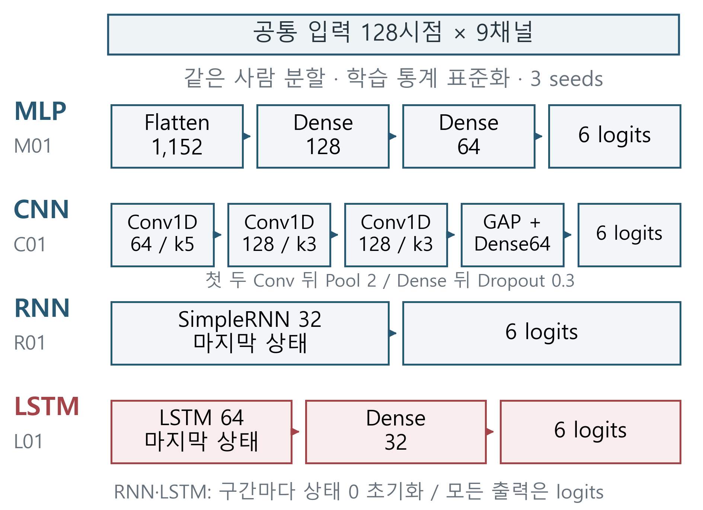
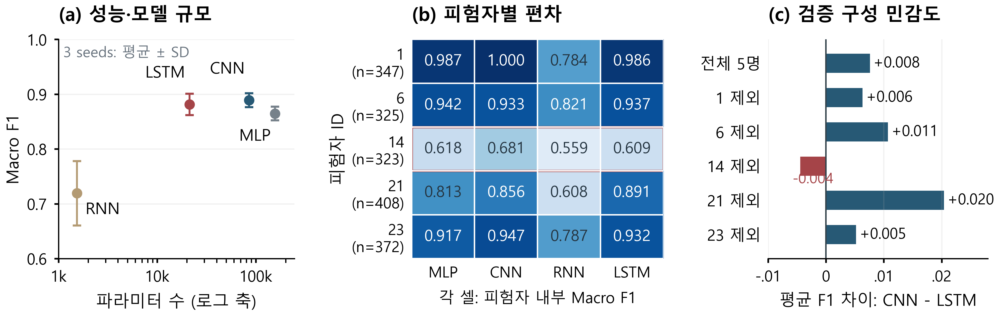

# DCS 대학생 공동 논문 v6

2026-10-14 · **스마트폰 행동 인식 신경망의 성능·규모 절충과 피험자별 편차 분석**

첫 페이지에 네 모델 구조도와 간결한 비교표, 둘째 페이지에 양단 폭의 세 패널 결과 그림을 배치했다. 성능·모델 크기, 피험자별 편차, 검증 구성 민감도를 한 그림에서 읽을 수 있다. 공식 양식의 용지·여백·본문 10pt와 2단 본문, 두 쪽 분량을 유지한다. 결과·저자 정보는 그대로다.

| 파일 | 용도 |
| --- | --- |
| [학회 양식 HWP](DCS_2026_대학생_논문개정_v6.hwp) | 수정·투고 준비용 한글 원고 |
| [PDF 미리보기](DCS_2026_대학생_논문개정_v6.pdf) | 위 HWP를 한글에서 직접 내보낸 두 쪽 PDF |
| [본문 MD](DCS_TEAM_PAPER_KO.md) | 같은 본문·표·그림의 검토 원문 |
| [지면·그림 편집 설명](VISUAL_LAYOUT_KO.md) | 배치·패널·축·반올림·출처·재생성 명령 |
| [발표 설명·질의응답](PRESENTATION_QA_KO.md) | 그림 읽는 순서와 예상 질문 19개 |
| [기존 연구 보강 근거](RESEARCH_QUALITY_V4_KO.md), [문헌 검토](PROCEEDINGS_REVIEW_KO.md) | 피험자 구성 진단의 수식·모든 경우·한계 및 선행 연구 |
| [그림 PNG·SVG](figures/), [표시 데이터](VISUAL_FIGURE_DATA.json) | 구조도·통합 결과 그림·기존 보충 그림과 정확한 값 |
| [진단 CSV](diagnostic_data/), [검증 기록](VERIFICATION.json), [출처](SOURCE_INDEX.json) | 72개 지표 대조 및 HWP·PDF·이미지·데이터 검증 |

저자는 **이봉헌·유재윤·정회서·한윤섭·최승빈**, 제1저자·발표자는 이봉헌, 지도교수는 황세웅이다. 소속·이메일은 제공된 응용프로젝트 프로필에서 확인했다. 사사 적용·최종 문구와 교신저자·최종 투고 내용은 확인할 항목이다.

공개 원고의 사사는 확인 후 기재 예정이다. 학교 지원 서류·학번·전화번호·동의서와 타인 원고 전문은 이 묶음에 포함하지 않았다. 사사 확인용 학교 별첨은 로컬에 보관한다.

대표 결과는 개발 검증 5명·1,775구간, M01·C01·R01·L01의 세 seed다. 검증은 epoch 선택에도 사용했으며 공식 test는 미평가다. SD는 사용자 신뢰구간이 아니다. 구성 진단은 저장 예측의 사후 분석이며 재학습·인과 효과·성능 개선을 뜻하지 않는다. 모델 용량·헤드·Dropout·탐색 예산 차이로 순수 구조 효과를 분리하지 못했다. 모바일 속도·전력·통계적 동등성·최적 구조는 입증하지 않았다.

그림은 `tools/make_research_figure.py`, 구성 진단은 `tools/analyze_subject_composition.py`로 재생성한다. [앞선 v5](../dcs-team-paper-research-v5/README.md)와 기존 상세 보고서·수업 PPT는 수행 기록으로 보존한다. 이 원고는 제출·채택·수상을 완료한 자료가 아니다.
