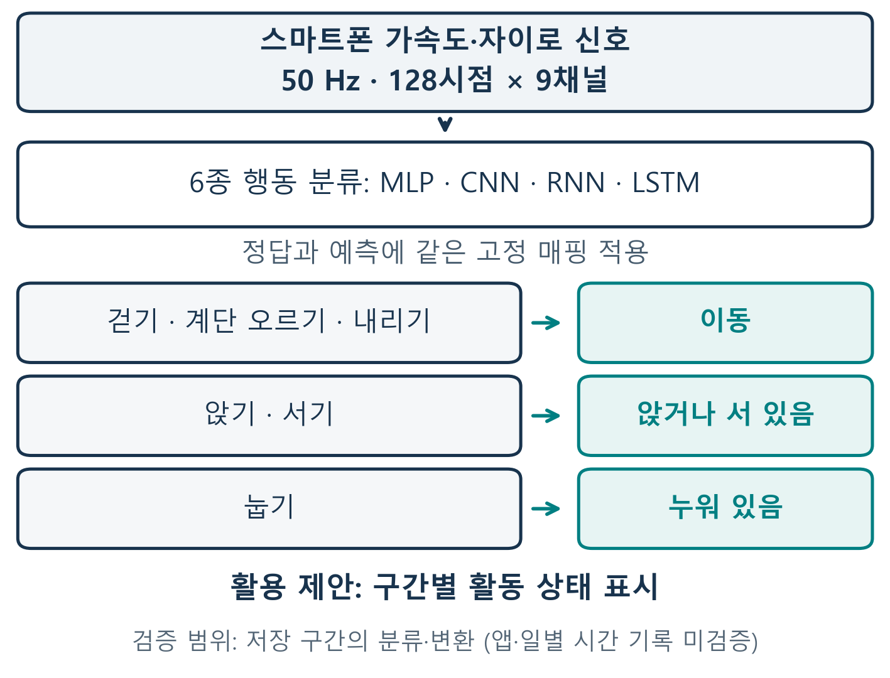
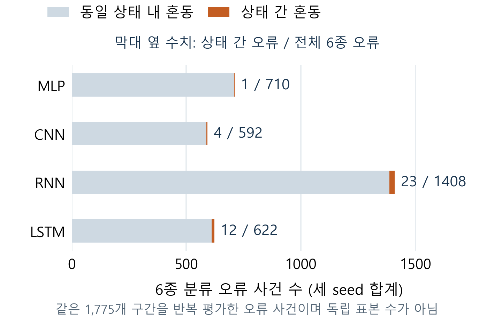

# 스마트폰 내장 센서 기반 일상 활동 요약을 위한 신경망 비교

> 2026-10-19 · v8 검토 원고. 개발 validation 결과이며 공식 test는 미평가다. 사사 적용 여부는 확인 전이다.

이봉헌(\*), 유재윤(\*\*), 정회서(\*\*\*), 한윤섭(\*\*\*\*), 최승빈(\*\*\*\*\*)
(\*, \*\*) 선문대학교 AI소프트웨어학과, {bongbong9292, zoroi24}@naver.com
(\*\*\*) 선문대학교 AI소프트웨어학과, hoeseo4019@sunmoon.ac.kr
(\*\*\*\*, \*\*\*\*\*) 선문대학교 AI소프트웨어학과, {nfsodv0929, ramongrupy}@gmail.com
지도교수(Supervisor) : 황세웅

## 1. 연구 배경

스마트폰 내장 가속도·자이로 센서는 추가 센서 없이 활동을 파악하는 입력이다[1]. 활동 기록은 이동 여부만 필요한 기능과 계단·앉기를 구분하는 기능에서 요구 출력이 다르다. 본 연구는 네 신경망의 6종 예측을 3상태로 변환해 세부 동작 오류가 요약 상태까지 바꾸는지 확인하고, 출력 구분 수준과 모델 규모를 함께 고려하는 선택 근거를 제시한다.

## 2. 연구 내용

2.1 데이터와 비교 조건

UCI HAR[1]의 허리 착용 스마트폰 신호를 50Hz·128시점×9채널(신체 가속도·각속도·총 가속도의 xyz)로 입력했다. 제공 필터링·50% 중첩을 유지하고 공식 학습 자료를 학습 16명·5,577구간, 검증 5명·1,775구간(1·6·14·21·23)으로 분리했다. 사람 독립 평가[2]를 위해 사람·표본 ID 중복을 배제하고 학습 통계로 한 번 표준화했다.

MLP는 Flatten-128-64, CNN은 Conv(64,128,128)-전역평균풀링-64, RNN은 SimpleRNN 32, LSTM은 LSTM 64-Dense 32를 사용하고 각각 6 logits를 출력했다. 순환 모델은 구간별 상태를 초기화하고 마지막 출력을 사용했다. CNN Dense 뒤 Dropout은 0.3, 다른 기준 구성은 0이다.

Adam 0.001, batch 64, 최대 40 epoch, 희소 교차 엔트로피와 검증 손실 기준 early stopping(patience 6, 최선 복원)을 적용했다. 기준 M01·C01·R01·L01을 seed 2026·2027·2028로 학습한 12회 결과를 비교했다.

2.2 활동 요약 규칙과 평가

그림 1의 규칙으로 6종을 ‘이동’, ‘앉거나 서 있음’, ‘누워 있음’으로 묶었다. 저장된 argmax 예측과 정답에 같은 매핑을 적용한 사후 분석으로 재학습은 없다. 각 과제의 클래스별 F1을 평균한 Macro F1과 6종 오류 중 상태 간 오류로 남는 수를 계산했다.

그림 1. 센서 입력과 활동 상태 요약 절차

2.3 결과와 모델 선택

6종 F1은 CNN이 가장 높았다(표 1). LSTM은 CNN보다 파라미터가 75.2% 적고 F1 차이는 0.0076이었다. 3상태 F1은 모두 0.9960 이상이지만, 더 쉬운 과제의 결과로 6종 성능 개선을 뜻하지 않는다.

표 1. 개발 검증 Macro F1 평균 ± seed 표본 SD

| 모델·조건 | 파라미터 | 6종 Macro F1 평균 ± SD | 3상태 Macro F1 평균 ± SD |
| --- | ---: | ---: | ---: |
| MLP M01 | 156,230 | 0.8646 ± 0.0125 | 0.9998 ± 0.0003 |
| CNN C01 | 85,574 | 0.8889 ± 0.0127 | 0.9994 ± 0.0003 |
| RNN R01 | 1,542 | 0.7191 ± 0.0586 | 0.9960 ± 0.0032 |
| LSTM L01 | 21,222 | 0.8813 ± 0.0195 | 0.9980 ± 0.0012 |

6종 오류 중 동일 상태 내 혼동은 MLP 99.9%, CNN 99.3%, RNN 98.4%, LSTM 98.1%였다(그림 2). LSTM의 622회 오류 중 610회는 상태 내, 12회는 상태 간 혼동이었다. 합계는 같은 1,775구간의 반복 평가이며 독립 표본 수가 아니다.

그림 2. 6종 오류의 상태 내·상태 간 구성

계단 오르기→걷기 오류는 ‘이동’ 표시에서는 맞지만 계단 기록에는 틀린다. 파라미터 1,542개의 RNN도 3상태 F1 0.9960으로 소형 후보가 된다. 보조 조건 LSTM 32(6,630개)는 0.9982±0.0005였으며 공동 비교의 기준 LSTM을 대체하지 않았다.

## 3. 현실적 제한 조건에 대한 검토

검증은 epoch 선택에 사용한 개발 자료이며 공식 test는 미평가다. 단일 분할·세 seed 및 용량·헤드·Dropout 차이로 일반화·순수 구조 효과를 입증하지 못한다. 매핑은 사후 분석이며 기기 지연·전력과 다른 휴대 위치·전환 동작은 미검증이다.

## 4. 기대효과 및 활용

카메라·GPS 없이 센서 구간을 이동·자세 상태로 표시하는 활동 요약의 가능성을 확인했다. 다만 묶은 자세로 앉은 시간을, 눕기로 수면을 판단할 수 없다. 앱·일별 지속시간은 구현 범위가 아니다. 후속 연구에서는 단순 특징·선형 기준과 비교하고 연속 신호 및 실제 기기에서 검증해야 한다.

## 5. 결론

개발 자료에서 세부 오류의 98.1~99.9%는 같은 활동 상태 안에 머물렀다. 따라서 표시할 상태를 정한 뒤 그 수준의 오류와 모델 규모를 평가해야 한다. 본 연구는 스마트폰 센서만으로 큰 활동 상태를 요약하는 소형 모델 후보를 제시했다. 계단·앉기 등 세부 기록은 별도 검증이 필요하다.

## 참고 문헌

[1] J. L. Reyes-Ortiz et al., “Human Activity Recognition Using Smartphones,” UCI Machine Learning Repository, 2013. DOI: 10.24432/C54S4K.

[2] S. Scheurer et al., “Comparing Person-Specific and Independent Models on Subject-Dependent and Independent Human Activity Recognition Performance,” Sensors, 20(13), 3647, 2020.

## 감사의 글

연구 지원 적용 여부와 학교 사사 문구 확인 후 최종 기재할 예정이다.
