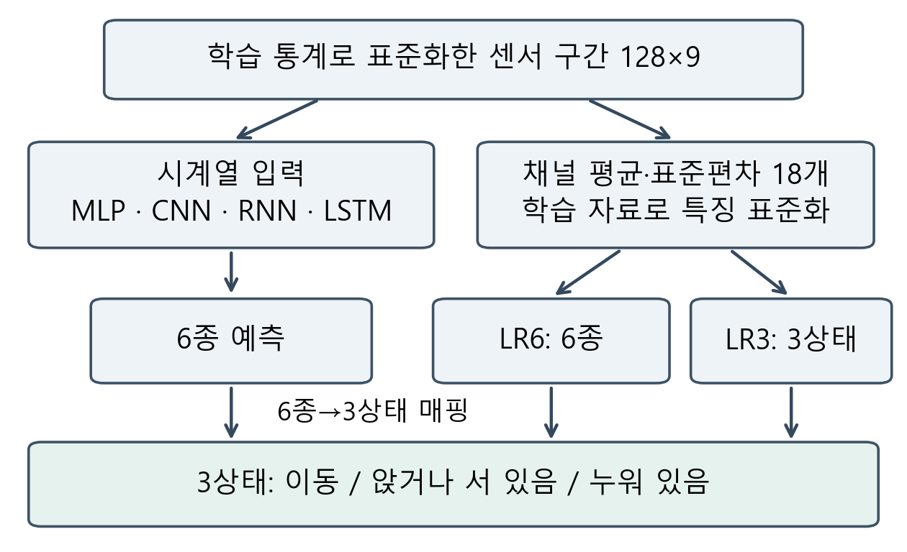
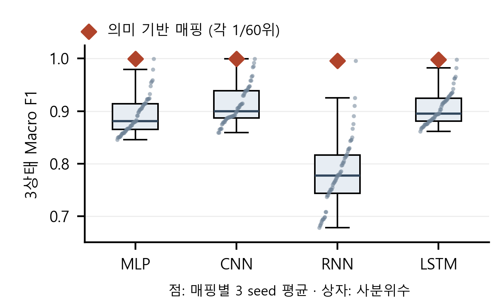

# 스마트폰 활동 요약을 위한 행동 구분 수준과 분류기 복잡도 분석

> 2026-10-19 · v9.1 검토 원고. 개발 validation 결과이며 공식 test는 미평가다. 사용자 요청에 따라 컴퓨터비전 논문의 사사 문구를 그대로 적용했다.

이봉헌(\*), 유재윤(\*\*), 정회서(\*\*\*), 한윤섭(\*\*\*\*), 최승빈(\*\*\*\*\*)
(\*, \*\*) 선문대학교 AI소프트웨어학과, {bongbong9292, zoroi24}@naver.com
(\*\*\*) 선문대학교 AI소프트웨어학과, hoeseo4019@sunmoon.ac.kr
(\*\*\*\*, \*\*\*\*\*) 선문대학교 AI소프트웨어학과, {nfsodv0929, ramongrupy}@gmail.com
지도교수(Supervisor) : 황세웅

## 1. 연구 배경

스마트폰 센서 기반 행동 인식[1]에서 활동 기록의 목적에 따라 필요한 구분 수준은 다르다. 본 연구는 네 신경망과 선형 분류기를 비교하고 6종 행동을 3상태로 요약할 때의 오류를 분석하여, 큰 상태 요약에도 복잡한 시계열 모델이 필요한지 검토한다.

## 2. 연구 내용

2.1 데이터와 신경망 비교

UCI HAR[1]의 허리 착용 스마트폰 신호(50Hz)를 128시점×9채널(신체 가속도·각속도·총 가속도의 xyz)로 입력했다. 제공 필터링·50% 중첩을 유지하고 공식 학습 자료를 학습 16명·5,577구간, 검증 5명·1,775구간으로 나눴다. 사람·표본 ID 중복을 배제한 평가[2]이며 학습 통계로 표준화했다.

MLP는 Flatten-128-64, CNN은 Conv(64,128,128)-전역평균풀링-64, RNN은 SimpleRNN 32, LSTM은 LSTM 64-Dense 32로 각각 6 logits를 출력했다. 순환 모델은 구간별 초기 상태와 마지막 출력을 사용했다. Dense 뒤 Dropout은 CNN만 0.3, 나머지는 0이다.

Adam 0.001, batch 64, 최대 40 epoch, 희소 교차 엔트로피, 검증 손실 early stopping(patience 6, 최선 복원)을 공통 적용했다. seed 2026·2027·2028의 12회 결과를 비교했다.

2.2 요약 과제와 대조 실험

걷기·계단 오르기·내리기를 이동, 앉기·서기를 앉거나 서 있음, 눕기를 누워 있음으로 묶었다. 6종 argmax와 정답을 동일하게 매핑해 Macro F1을 계산했다. 병합 효과를 비교하기 위해 같은 그룹 크기(3·2·1)의 60개 매핑을 모두 평가했다.

그림 1의 선형 대조는 채널별 시간 평균·표준편차 18개를 사용한다. 학습 자료로 특징을 표준화한 뒤 L2 로지스틱 회귀(C=1, lbfgs, 최대 2,000회)를 6종(LR6)과 직접 3상태(LR3)에 각각 한 번 학습했다. 추가 조건은 실행 전 고정하고 조정하지 않았다. 대조와 매핑 분석은 기존 신경망 결과를 본 뒤 설계했다.

그림 1. 시계열·통계 특징 경로와 평가 출력

2.3 결과 및 해석

6종 F1은 CNN 0.8889, LSTM 0.8813으로 LR6의 0.7742보다 높았다(표 1). 반면 LR6를 요약하면 0.9985였고, LR3는 검증 1,775구간에서 오류가 없었다. 이 분할의 상태 요약에는 신경망이 필수라는 근거가 없었다.

표 1. 개발 검증 F1과 분류기 파라미터 수

| 모델·조건 | 파라미터 | 6종 Macro F1 평균 ± SD | 3상태 Macro F1 평균 ± SD |
| --- | ---: | ---: | ---: |
| MLP M01 | 156,230 | 0.8646 ± 0.0125 | 0.9998 ± 0.0003 |
| CNN C01 | 85,574 | 0.8889 ± 0.0127 | 0.9994 ± 0.0003 |
| RNN R01 | 1,542 | 0.7191 ± 0.0586 | 0.9960 ± 0.0032 |
| LSTM L01 | 21,222 | 0.8813 ± 0.0195 | 0.9980 ± 0.0012 |
| LR6 | 114 | 0.7742 | 0.9985 |
| LR3 | 57 | — | 1.0000 |

신경망은 세 seed 평균±표본 SD, LR은 단일 학습이다. LR3만 3상태를 직접 학습했다. 파라미터 수는 가중치·편향만 세며 특징 계산 비용은 제외한다. 과제 간 점수 차이는 6종 성능 향상이 아니다.

그림 2. 60개 매핑의 F1 분포와 의미 기반 매핑

의미 기반 매핑은 네 모델 모두 세 seed 평균에서 60개 중 유일한 1위였다. 매핑별 F1 중앙값은 0.7775~0.8995였다. 매핑별 표본 분포가 달라 통계적 유의성은 미검증이다.

## 3. 현실적 제한 조건에 대한 검토

단일 개발 분할이며 신경망 epoch 선택에도 사용했다. 공식 test는 미평가다. 용량·헤드·입력 표현이 달라 순수 구조 효과를 분리하지 못한다. LR3의 무오류는 다른 사람·휴대 위치에서 보장되지 않으며 기기 지연·전력·전환 동작도 미검증이다.

## 4. 기대효과 및 활용

카메라·GPS 없이 이동·자세 상태를 표시하는 활동 기록의 기초 모듈로 활용할 수 있다. 요약은 통계 특징·선형 모델부터 검토하고, 계단·앉기 기록은 세부 성능으로 구성을 비교하도록 제안한다. 눕기는 수면을 뜻하지 않으며 앱·일별 지속시간은 구현하지 않았다.

## 5. 결론

비교한 구성에서 CNN·LSTM은 세부 구분에 유리했고, 3상태 요약은 57개 파라미터의 선형 모델로도 이 개발 분할에서 가능했다. 표시할 활동을 먼저 정하고 그 수준의 오류와 복잡도를 평가해야 한다. 후속 독립 사람 분할과 연속 휴대 신호에서 재현성을 검증할 예정이다.

## 참고 문헌

[1] J. L. Reyes-Ortiz et al., “Human Activity Recognition Using Smartphones,” UCI Machine Learning Repository, 2013. DOI: 10.24432/C54S4K.

[2] S. Scheurer et al., “Comparing Person-Specific and Independent Models on Subject-Dependent and Independent Human Activity Recognition Performance,” Sensors, 20(13), 3647, 2020.

## 감사의 글

본 연구는 2026년도 과학기술정보통신부 및 정보통신기획평가원의 ‘SW중심대학지원사업’의 연구 결과로 수행되었습니다(2024-0-00023).
