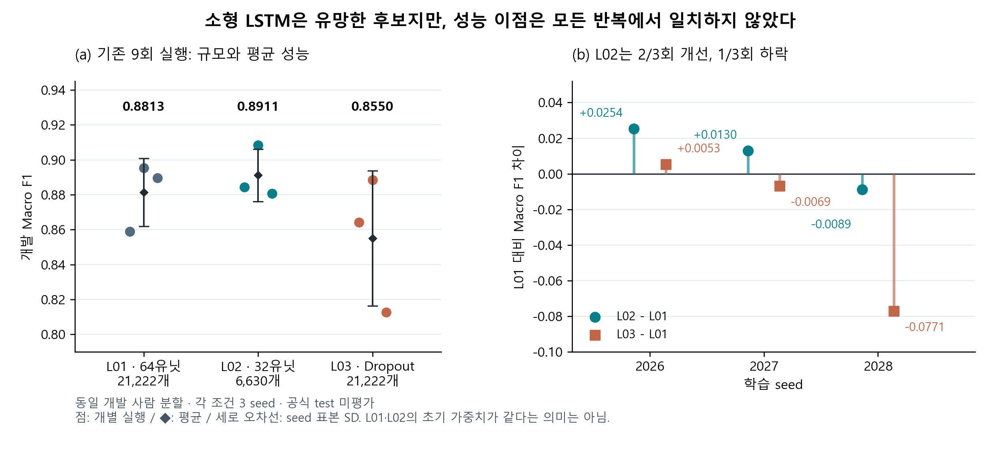

# 현재 논문의 기여 진단과 개정 방향

2026-10-15 · v7 이후 연구 내용 검토안. 이번 작업은 기존 결과의 재검산과 원고 구성 제안이다. 새 학습·공식 test 평가는 수행하지 않았다. 아래 문단은 아직 v7 HWP·학교 지원 서류를 대체하지 않는다.

## 판단

현재 v7은 재현 가능한 비교 자료를 갖췄지만, 결론이 점수 요약과 후속 과제에 머물러 있다. 핵심 문제는 결론의 길이나 그림 수보다 **연구 질문 → 조작한 조건 → 관찰한 차이 → 그 차이에 근거한 선택**의 연결이 약하다는 점이다. 비교 연구도 연구가 될 수 있지만, 기존 HAR 연구와 구별되는 새로운 방법이나 충분한 일반화 검증을 현재 확보했다고 보기 어렵다. 문장을 강하게 바꾸는 것만으로 이 한계가 해결되지는 않는다.

## 업로드한 두 쪽 논문에서 참고할 점

이번에는 제공된 DCS 하계 논문집에서 다음 세 편의 전체 여섯 쪽을 다시 확인했다. 앞선 네 편·여덟 쪽 검토 중 결론의 논리와 직접 관련된 사례를 골랐다.

| 사례 | 그 논문이 보고하는 연구 결과의 연결 | 우리에게 적용할 점 |
| --- | --- | --- |
| 인하대, N-BEATS와 Time-o1 손실 결합, 인쇄 312–313쪽 / PDF 396–397쪽 | 구조를 유지하며 손실을 변경하고, 기준 대비 결과와 실패 설정을 보고한다. | 하나의 설계 변경을 특정하고, 유리한 결과와 불리한 반복을 함께 설명한다. |
| 서울여대, 신용카드 이상거래 탐지, 인쇄 322–323쪽 / PDF 406–407쪽 | 여러 모델과 앙상블을 비교한 후, 제시한 F1 기준으로 단일 RF를 선택한다. | 복잡한 방법을 시도했다는 사실보다 어떤 근거로 최종 후보를 좁혔는지가 중요하다. |
| 중앙대, HMD 머리 움직임 분류, 인쇄 297–298쪽 / PDF 379–380쪽 | 수집한 센서의 분류 결과를 외부 장치 없는 보조 입력의 가능성에 연결한다. | 측정 결과가 어떤 사용 결정을 지원하는지 명시하되 실제 적용 검증과 가능성을 구분한다. |

위 비교는 논증 구조를 참고한 것이다. 참고 논문의 모든 수치·설계·해석을 독립 검증한 것은 아니다. 특히 서울여대 사례는 본문 일부와 표의 수치가 일치하지 않는 부분이 있어 그 수치를 우리 연구 근거로 옮기지 않았다. 수상 여부도 확인하지 않았다. 타 논문의 문장·그림을 복제하지 않았다.

원본 논문집 SHA256: `7dcd5bdfdef8a986db255826d91c5a78814d5104a0026fb82eb9a53d21a93a56`.

## 지금 활용할 수 있는 실질적 실험

봉헌 담당의 사전 계획에 포함된 L01·L02·L03이 이미 존재한다. v7 본문은 네 기준 모델의 비교와 피험자 분석을 중심으로 작성되어 이 통제 실험의 역할이 드러나지 않았다. 이를 별도 보조 실험으로 본문에 연결하는 것이 현재 자료로 가능한 가장 직접적인 보강이다.

연구 질문은 다음처럼 정리할 수 있다.

> 스마트폰 행동 인식에서 LSTM의 은닉 규모를 줄였을 때 모델 규모와 개발 성능은 어떻게 달라지며, 이 변화가 사용자별 취약성까지 완화하는가?

질문을 개정 원고의 중심에 놓는 것은 지금의 편집적 판단이다. 해당 질문을 처음부터 논문 전체의 사전 등록된 가설로 설정했다고 쓰지 않는다. 다만 L02의 은닉 크기 축소와 L03의 Dropout 조건 자체는 기존 실행 계획에 명시된 실험이다.

| 조건 | 은닉 수 / 외부 Dropout | 파라미터 | 개발 Macro F1 평균 ± seed SD | L01 대비 평균 차이 |
| --- | --- | ---: | ---: | ---: |
| L01 기준 | 64 / 0.0 | 21,222 | 0.8813 ± 0.0195 | 기준 |
| L02 소형 | 32 / 0.0 | 6,630 | 0.8911 ± 0.0150 | +0.0098 |
| L03 Dropout | 64 / 0.3 | 21,222 | 0.8550 ± 0.0387 | −0.0262 |

각 조건은 동일 개발 사람 분할의 seed 2026·2027·2028 세 번이다. SD는 seed 표본 SD이며 사용자 모집단의 신뢰구간이 아니다.

이 그림은 기존 실험의 재표현이다. 왼쪽 점은 개별 실행, 검정 마름모는 평균, 세로선은 seed 표본 SD다. 오른쪽은 같은 seed 표기의 L01 대비 차이이며 크기가 다른 L01·L02의 초기 가중치가 같다는 의미는 아니다.

## 결과에서 도출할 수 있는 판단

1. **소형 LSTM을 후속 검증 후보로 좁힐 근거가 있다.** 은닉 수를 64에서 32로 변경한 L02는 파라미터가 68.8% 적고, 이 개발 분할의 평균 F1은 0.0098 높았다. 고정된 세 반복에서는 더 큰 LSTM 구성이 평균 성능의 우위를 보이지 않았다.
2. **소형화의 성능 이점이 모든 반복에서 재현된 것은 아니다.** L02−L01 차이는 seed 2026·2027·2028에서 각각 +0.0254, +0.0130, −0.0089였다. 두 번 개선되고 한 번 낮아졌으므로 성능 개선을 확정하거나 비열등성을 입증했다고 쓰지 않는다.
3. **검토한 Dropout 조건이 평균 성능을 높이지는 않았다.** L03의 평균 차이는 −0.0262였고 세 반복 중 두 번 낮았다. ‘정규화는 불필요하다’ 또는 ‘과적합이 원인이 아니다’로 확대하지 않는다. 학습 전 가중치 일치는 L01·L03에만 검증되어 있다.
4. **모델 규모와 사용자별 취약성은 별도로 검증해야 한다.** L02의 피험자 14 내부 F1 seed 평균은 0.6597로, 이 조건의 다섯 사람 중에서도 최저였다. L01의 0.6089보다 평균은 높지만 취약성이 해소되었다고 볼 수 없다. 전체 F1과 피험자 내부 F1은 산출 집단이 다른 지표다.

따라서 연구 결과는 **‘현재 조건에서 규모 축소가 유망한 선택지라는 근거를 얻었고, 사용자별 취약성까지 해결하는지는 별도 문제임을 확인했다’**로 정리할 수 있다. 이는 새로운 LSTM 알고리즘의 발명이나 모든 HAR 데이터에서의 우월성 주장이 아니다.

## 공동 논문에서의 배치

- **공동 비교:** MLP M01·CNN C01·RNN R01·LSTM L01의 원래 비교표를 유지한다. 전처리와 각 팀원의 모델 구현이 이 비교의 기반이다.
- **설계 검토:** L01·L02·L03을 별도 소절과 표로 제시한다. L02가 CNN보다 높은 평균을 보였다는 이유로 공동 비교의 대표를 교체하거나 구조 우승을 선언하지 않는다.
- **한계 진단:** 피험자별 결과로 모델 규모를 줄인 실험이 어떤 문제를 해결하지 못했는지 보여준다. 제외 진단 전체는 보충 자료에 보존할 수 있다.
- **결론:** 소형 구성의 후속 검증 후보 선정, 그 근거와 남은 사용자별 한계를 답한다.

권장 제목은 **‘스마트폰 행동 인식 신경망 비교와 LSTM 용량 조절의 효과 분석’**이다. 두 쪽에는 공동 비교표, LSTM 조건 비교표, 조건별 결과·피험자 진단 그림을 우선 배치하고, 일반적인 네 구조 그림은 보충 자료로 옮기는 편이 연구 질문에 더 직접적이다. 본문·그림·표 번호를 함께 고쳐야 하므로 결론 문단만 v7 끝에 붙이는 방식은 피한다.

[방법·결과·활용·결론의 실제 수정 문단](PROPOSED_SECTIONS_KO.md)을 별도로 작성했다. 이는 편집 초안이며 native HWP의 두 쪽 배치 검증을 마친 새 제출본이라는 뜻은 아니다.

## 더 강한 근거를 만들 다음 실험

우선순위는 모델 종류를 더 늘리는 것보다 **L01 대 L02의 결과가 다른 사람 분할에서도 반복되는지** 확인하는 것이다. 이는 미실행 후속 권고다.

공식 학습 자료 21명 안에서 사람 단위의 외부 평가 분할과 내부 early stopping 분할을 미리 고정한다. 전처리 통계는 각 분할의 실제 학습 사람에서만 구하고, 외부 평가 사람은 epoch 선택에 사용하지 않는다. 두 조건에 동일 분할·seed·학습 규약을 적용하고, 전체 F1과 사람별 F1·규모를 함께 보고한다. 검증 피험자만 제외하고 저장 예측을 다시 집계하는 현재 민감도 분석과는 다른 재학습 실험이다.

평균 성능 개선을 주장하려면 분할별 차이와 악화 사례까지 제시해야 한다. ‘성능을 유지하면서 작아졌다’는 비열등성 주장에는 응용 요구에 근거한 허용 하락 폭과 적절한 불확실성 평가가 먼저 필요하다. 관찰된 차이에 맞춰 허용 폭을 정하지 않는다. 여러 seed·분할을 모두 독립적인 새 사용자 표본처럼 취급하지 않는다. 이 내부 재검증도 별도의 새 사용자 외부 검증을 대신하지 않는다.

공식 test 평가 보류 조건은 유지한다. 실제 스마트폰의 속도·메모리·전력에 관한 결론을 넣으려면 별도 기기 측정이 필요하다. 현재 원고의 실질적 기여는 규모에 관한 설계 선택과 사용자별 한계에 대한 개발 단계의 근거다.

## 검산 기록

`python tools/audit_lstm_contribution.py`로 기존 9개 혼동행렬의 6클래스 Macro F1·Accuracy를 재계산했고, 기존 CSV와 1e-12 이내로 일치했다. LSTM 파라미터 수를 층별 식으로 계산해 대조하고, 평균·표본 SD·seed 차이를 재계산했다. L01·L02 설정은 은닉 수·조건 이름만 달랐다. 사람별 값은 기존 감사된 CSV를 집계했으며 이번에 원시 예측을 독립적으로 다시 계산한 것은 아니다.

[EVIDENCE.json](EVIDENCE.json)에 정밀 수치·출처 해시·검산 범위를 보존했다. 기존 HWP·학교 서류·학습 기록은 변경하지 않았다.
