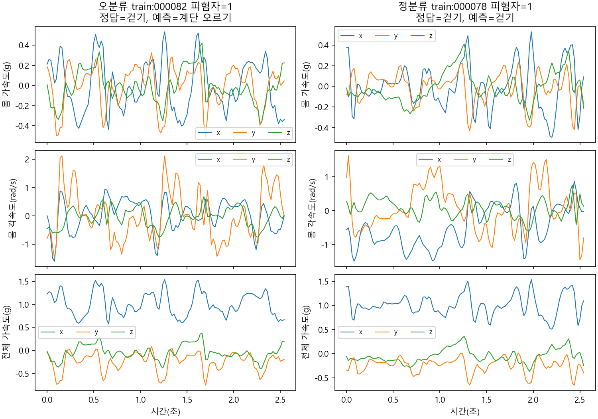
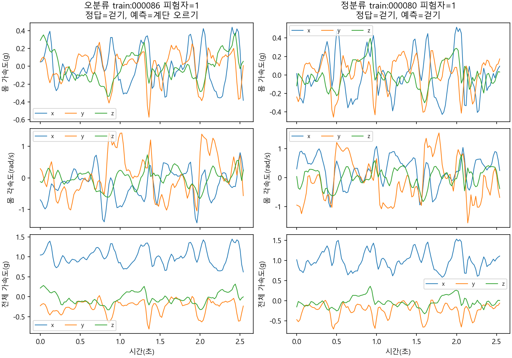
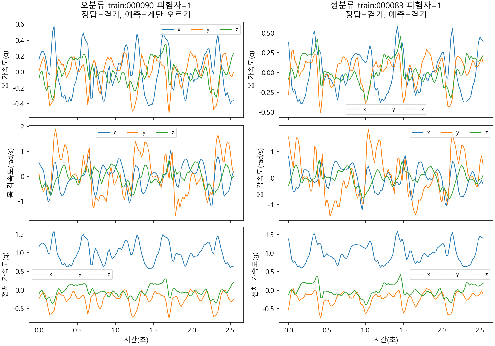

# RNN 오류와 성공 파형 대조

가장 큰 방향성 혼동에서 원본 행 번호가 빠른 오분류 세 개와, 같은 정답 클래스의 성공 사례를 같은 수로 선택했다. 가능한 경우 같은 사람을 우선했다. 사례는 무작위 대표 표본이 아니며 파형만으로 원인을 확정하지 않는다. 시계열은 표준화 전 값이고 가로축은 초, 세로축은 가속도 g와 각속도 rad/s다. 재생성 명령은 `python reports/rnn/reproduce_diagnosis.py`다.

오류 `train:000082`와 성공 `train:000078`의 비교 조건은 같은 피험자·같은 정답 행동다.

오류 `train:000086`와 성공 `train:000080`의 비교 조건은 같은 피험자·같은 정답 행동다.

오류 `train:000090`와 성공 `train:000083`의 비교 조건은 같은 피험자·같은 정답 행동다.

