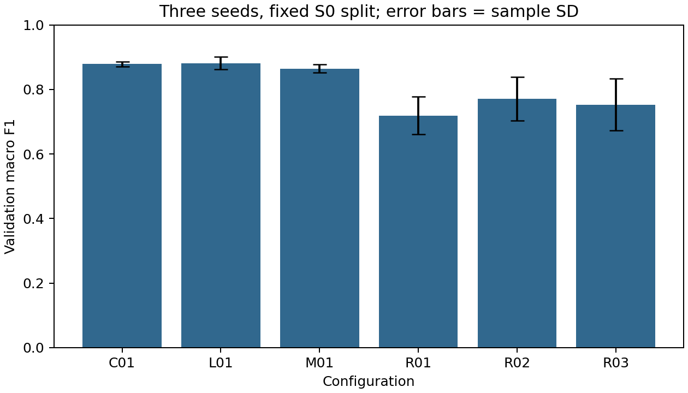
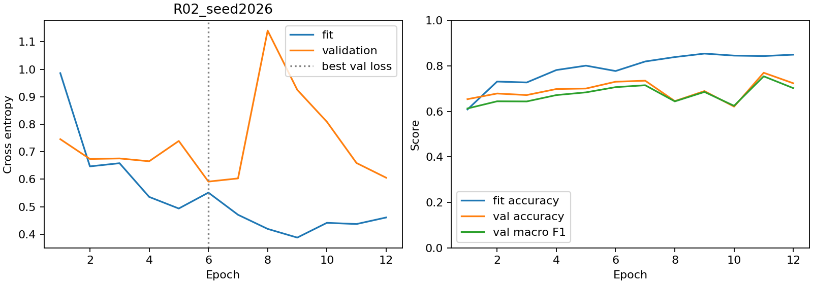
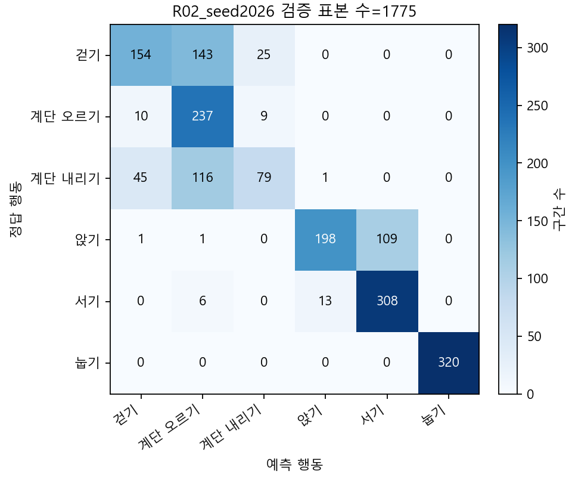

# 유재윤 RNN 담당 파트 결과 보고서

작성일: 2026년 10월 13일 · 담당자: 유재윤

## 수행 범위

SimpleRNN 설계·구현, 기준 학습, 하이퍼파라미터 튜닝, 검증 성능 평가, 학습 곡선과 혼동행렬, 피험자·행동별 오류 분석, 재현 확인, 팀 원고와 발표 자료를 정리했다. RNN R01·R02·R03만 게시한다. 팀 전체 모델 비교는 각 담당자의 공식 결과와 조건이 모인 뒤 수행할 공동 업무로 남긴다.

## 데이터와 구조

입력은 128시점 × 9센서 채널, 라벨은 걷기·계단 오르기·계단 내리기·앉기·서기·눕기의 6개다. 제공 NPZ는 표준화 전 배열이므로 학습 16명 5,577개에서 계산한 저장 통계를 한 번 적용했다. 검증은 피험자 1·6·14·21·23의 1,775개다. 사람 ID는 입력 특성이 아니며 분할과 오류 분석에만 사용했다. 공식 test는 읽거나 평가하지 않았다.

각 구간 시작 은닉 상태를 0으로 초기화한다. tanh SimpleRNN의 마지막 은닉 출력을 Dense 6에 넣고 로짓을 출력한다. R01 은닉 32개는 1,542개 파라미터, R02·R03 은닉 64개는 5,126개다. R03만 최종 은닉 출력에 Dropout 0.3을 적용한다. 순환 내부 Dropout·상태 유지·기울기 clipping은 사용하지 않았다.

## 학습과 선택

Adam 학습률 0.001, 배치 64, 최대 40에포크, 검증 손실 기준 조기 종료 patience 6과 최선 가중치 복원을 사용했다. seed 2026·2027·2028을 모두 실행했다. R03은 같은 seed R02의 **학습 전** 가중치를 복사해 시작했다. 후보 중 세 seed의 검증 Macro F1 평균이 가장 높은 R02를 선택했다. 기준 R01과 튜닝 선택 R02를 구분한다.

| 조건 | 파라미터 수 | 검증 정확도 평균 ± 표본 SD | 검증 Macro F1 평균 ± 표본 SD |
|---|---:|---:|---:|
| R01: 은닉 32 | 1,542 | 0.7356 ± 0.0497 | 0.7191 ± 0.0586 |
| R02: 은닉 64, 선택 | 5,126 | 0.7855 ± 0.0605 | 0.7715 ± 0.0675 |
| R03: 은닉 64 + 출력 Dropout 0.3 | 5,126 | 0.7654 ± 0.0670 | 0.7525 ± 0.0804 |

SD는 한 고정 피험자 분할에서 학습 seed 세 개의 표본 표준편차(ddof=1)이며 피험자 모집단의 신뢰구간이 아니다. R02의 평균 개선은 R01 대비 Macro F1 0.0524, 약 5.24%p다. 같은 검증셋을 조기 종료와 후보 선택에 사용했으므로 독립 최종 성능으로 해석하지 않는다. 모든 seed를 보존했으며 가장 높은 seed만 선택하지 않았다.

## 학습 특성과 오류

선택 조건의 설명·시연 seed는 2026이다. R02_seed2026의 최선 에포크는 6, 전체 학습은 12에포크다. 같은 최선 에포크에서 학습 정확도 0.7771, 검증 정확도 0.7301, 학습 손실 0.5513, 검증 손실 0.5914였다. 마지막 학습 손실 감소와 검증 손실 증가가 나타나 후반 과적합과 양립하지만 단일 원인으로 확정하지 않는다. 상세 수치는 [학습 진단](LEARNING_DIAGNOSIS_KO.md)에 있다.

선택 실행의 가장 큰 방향성 혼동은 걷기를 계단 오르기로 예측한 143개다. 같은 피험자·같은 정답의 오분류와 정분류 원 센서 파형 3쌍을 대조했다. 사례 선택 기준과 표본 ID는 [오류 분석](ERROR_CASES_KO.md), 전체 행동별 지표는 class_metrics.csv, 피험자별 지표는 subject_metrics.csv에 있다. 파형만으로 원인을 확정하지 않는다.

## 수치·저장 검증과 한계

작은 float64 RNN의 30개 파라미터 중심차분과 자동미분을 대조한 최대 절대 오차는 1.875e-11이다. 입력 계약·상태 초기화·파라미터 수·잘못된 입력 거부를 테스트했다. RNN 저장 모델 9개의 검증 전체 재로딩 기록과 원 예측을 보존했다. 초기 고정 배치 기울기 진단은 실제 갱신 배치나 시점별 기울기 소실을 측정한 자료가 아니며 소실·폭주를 입증하지 않는다.

실행 기록과 게시 소스의 차이 및 자료 출처는 [소스 이력 설명](../../reports/rnn/SOURCE_PROVENANCE_KO.md)에 정리했다. 공식 test와 팀 전체 비교는 최종 대상과 공통 조건을 확정한 뒤 진행한다.
