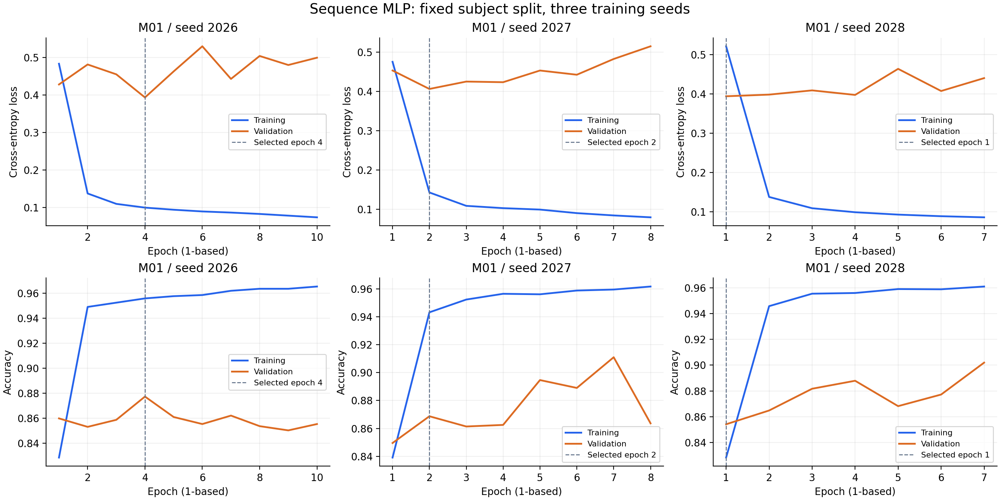
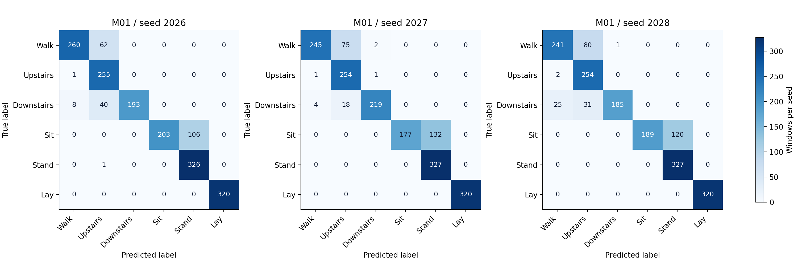

# 한윤섭 MLP 개인 논문 원고

작성자: 한윤섭 · 역할: ② MLP 구현·학습·평가 · 작성일: 2026-10-12 (한국 시간) 
상태: MLP 개발 실험 3회·평가·재로딩·근거 정리 완료. 공식 test와 팀 전체 비교는 후속 절차. 
학습 코드 버전: 기반 커밋 `5f760c3d681505f21b3a34b03a4f909f13c13e81`, 학습 전 고정한 코드 SHA-256 `39152401b2cbf1ac4db720ed6401e901def0b3ea4690e84536b6450a2a1b15a0`. 기반 커밋만으로 새 코드가 포함된 것으로 해석하지 않는다. 고정 소스는 [snapshot](../../../../reports/mlp_yoonseop/frozen_source/)에 있으며, 현재 배포본은 문서·증빙·배포 도구를 보완한 버전이다.

## 1 담당 목적

본 연구의 MLP는 스마트폰 센서 기반 사용자 독립 행동 인식에서 벡터 처리 기준모델의 성능을 측정하는 역할을 한다. UCI HAR[1,2]의 같은 128시점·9채널 구간을 CNN·SimpleRNN·LSTM과 공유하되, 모델 내부에서 1,152차원으로 펼친다. 시점별 값의 위치는 벡터에 남지만 시간축 합성곱의 가중치 공유나 순환 상태는 사용하지 않는다. 이번 자료는 MLP만 실제 실행한 결과이며, 다른 모델의 우열은 팀 결과를 취합한 뒤 판단한다.

## 2 실제 구조

기존 이봉헌의 E03 구현 `src/models/mlp.py`와 공통 trainer를 이어받았다. 모델은 Flatten[3], 128차원 ReLU Dense, 64차원 ReLU Dense, 여섯 개 선형 logits[4]로 구성하며 Dropout은 0이다. 파라미터는 각각 147,584·8,256·390개로 총 **156,230개**다. 학습 손실은 logits 기반 sparse categorical cross-entropy이고, 확률 저장 시 안정적인 softmax를 적용한다. 구조를 새로 제안한 연구로 서술하지 않으며 기존 수행자의 코드와 과거 점수는 출처를 유지한다.

| 층 | 출력 | 파라미터 |
|---|---|---:|
| 입력 | B × 128 × 9 | 0 |
| Flatten | B × 1,152 | 0 |
| Dense + ReLU | B × 128 | 147,584 |
| Dense + ReLU | B × 64 | 8,256 |
| 선형 Dense logits | B × 6 | 390 |
| 총합 | 6클래스 | 156,230 |

그림 1. M01의 입력·펼치기·은닉층·출력 구조. 원자료는 [model_structure.csv](../../../../reports/mlp_yoonseop/model_structure.csv)이며 파라미터는 저장 모델에서 다시 확인하였다.

## 3 데이터와 실험 조건

제공된 `processed_data.npz`는 기존 LSTM 실험과 같은 SHA-256의 전처리·분할 캐시다. fit 16명 5,577개와 validation 사람 `[1,6,14,21,23]`의 1,775개를 그대로 사용하고 사람 ID는 입력에서 제외하였다. Xs는 표준화 적용 전 배열임을 기존 통계와 대조하여 확인했으며, 공개 릴리스에서 복원한 원본 float32 fit 통계로 표준화를 한 번 적용하였다. 새 통계 추정·PCA·561특징 입력은 사용하지 않았다. 첨부 캐시의 0 시작 sample_id를 유지했고, 개발 loader는 fit/val의 입력·라벨·사람·ID만 읽는다. 최초 규격 점검에서 test 배열의 shape/dtype와 사람 목록은 확인했지만 test 예측·평가·튜닝은 수행하지 않았다.

| 항목 | 실제 값 | 근거 |
|---|---|---|
| 데이터 버전 | SHA-256 `00e8eae9edbcf37e1b01bb5a76b4f1da7bd21ca8d42a9beeccf4a483e7d3e459` | dataset_audit.json |
| 통계 버전 | SHA-256 `42b1b895d420a21ed7cce3b3636a4cbed96350953b27057c0670db9062d79fb2` | sequence_statistics.csv·preprocess.npz |
| 분할 | `team_s0_val_1_6_14_21_23` | 각 run의 split.json |
| 장치·버전 | CPU, Python 3.12.14, TF 2.21.0, Keras 3.15.1, NumPy 2.2.6, scikit-learn 1.7.2 | 각 run의 metadata.json |
| 모델 선택 | val_loss 최소 checkpoint, 최고 seed 선택 없음 | training_protocol.md·history.csv |

## 4 학습·검증 방법

Adam[5] 학습률 0.001, batch 64, 최대 40 epoch, val_loss 최소 기준 patience 6 및 최선 가중치 복원[6]을 사용하였다. 설정 M01을 결과 전에 고정하고 seed 2026·2027·2028을 모델 생성 전에 적용하였다. 같은 분할의 세 seed를 모두 집계했으며 추가 탐색으로 대표 조건을 바꾸지 않았다. 공통 지표 코드는 여섯 클래스를 항상 포함한 Macro F1[7]과 Accuracy를 계산한다. **48개 코드 검사**와 fit 60개·validation 30개의 2 epoch 연결 검사가 통과했고, 세 정식 모델마다 별도 프로세스에서 validation 전체를 재예측하였다.

## 5 결과

세 seed의 validation Macro F1은 **0.8646 ± 0.0125**, Accuracy 평균은 **86.67%**, Accuracy의 seed 표본 SD는 **1.17%p**였다. ±는 고정 사람 분할에서 세 학습 seed의 표본 표준편차(ddof=1)이며 사람 모집단의 신뢰구간이 아니다. 최선 epoch는 각각 4·2·1이고 실제 종료 epoch는 10·8·7이다. 저장 예측 CSV에서 지표·확률·행 대응을 재계산하여 일치를 확인했으며, 저장 모델 재로딩 후 전체 validation 확률의 최대 절대 차이는 **0.0e+00**였다. validation은 조기 종료에 사용했으므로 독립적인 최종 시험 성능으로 제시하지 않는다.

| run_id | validation Accuracy | validation Macro F1 | 선택 / 실행 epoch |
|---|---:|---:|---:|
| M01_seed2026 | 87.72% | 0.8753 | 4 / 10 |
| M01_seed2027 | 86.87% | 0.8676 | 2 / 8 |
| M01_seed2028 | 85.41% | 0.8509 | 1 / 7 |
| 평균 / seed 표본 SD | 86.67% / 1.17%p | 0.8646 ± 0.0125 | 3회 모두 포함 |

원자료: [runs.csv](../../../../reports/mlp_yoonseop/runs.csv), [summary.json](../../../../reports/mlp_yoonseop/summary.json), [seed별 전체 예측·학습·재로딩 증빙](../../../../reports/mlp_yoonseop/run_evidence/). 저장 모델과 동일 경로의 원본 실행 묶음은 [Release](https://github.com/kara320090/smartphone-har/releases/tag/yoonseop-mlp-v1)에 있다.

그림 2. seed별 학습·검증 loss와 Accuracy. 점선은 val_loss로 선택한 epoch이고 가로축은 1 시작 epoch다. 곡선의 학습 지표는 학습 도중의 batch 집계이며 최선 가중치 복원 후 fit 평가값과 구분한다. 원자료는 각 run의 history.csv다.

## 6 오류 분석과 한계

앉기의 평균 F1은 **0.7601**, recall은 **0.6138**로 가장 낮았다. 앉기를 서기로 예측한 표본은 seed 순서대로 106·132·120개였다. 사람 14의 평균 Macro F1은 **0.6181**로 다섯 검증 사람 중 가장 낮았으며, 세 seed 모두 틀린 동일 표본은 **173개**다. 최선 가중치의 fit Accuracy와 validation Accuracy 차이는 7.98~9.02%p이고, 곡선에서도 fit loss 감소와 validation loss의 상승·변동이 나타났다. 이는 이번 분할의 일반화 차이와 과적합 양상을 관찰한 것으로, 센서 자세·사람 특성 같은 오분류 원인을 확인한 실험은 아니다. 한 분할·세 seed와 제한된 모델·탐색 범위에서의 결과이며 추가 사람 분할, 새 장치, 공식 test에 대한 안정성은 검증하지 않았다.

| 클래스 | seed당 support | Precision 평균 | Recall 평균 | F1 평균 ± seed SD |
|---|---:|---:|---:|---:|
| 걷기 | 322 | 0.9486 | 0.7723 | 0.8512 ± 0.0318 |
| 계단 오르기 | 256 | 0.7134 | 0.9935 | 0.8304 ± 0.0122 |
| 계단 내려가기 | 241 | 0.9937 | 0.8257 | 0.9006 ± 0.0409 |
| 앉기 | 309 | 1.0000 | 0.6138 | 0.7601 ± 0.0323 |
| 서기 | 327 | 0.7329 | 0.9990 | 0.8453 ± 0.0135 |
| 눕기 | 320 | 1.0000 | 1.0000 | 1.0000 ± 0.0000 |

| 사람 ID | seed당 support | Accuracy 평균 | 6클래스 Macro F1 평균 ± seed SD |
|---|---:|---:|---:|
| 1 | 347 | 98.56% | 0.9871 ± 0.0064 |
| 6 | 325 | 94.15% | 0.9416 ± 0.0145 |
| 14 | 323 | 66.15% | 0.6181 ± 0.0181 |
| 21 | 408 | 81.21% | 0.8133 ± 0.0370 |
| 23 | 372 | 92.83% | 0.9173 ± 0.0055 |

그림 3. 정식 seed별 validation 혼동행렬. 행은 정답, 열은 예측이며 각 행렬은 동일한 1,775개 표본의 한 실행이다. 세 행렬을 독립 표본처럼 합산하지 않는다. 원자료는 `M01_seed*_confusion.json`; 클래스·사람별 원자료와 오류 ID는 [evidence_index.md](evidence_index.md)에 연결하였다.

## 7 실제 문제·검증과 기여

실행 환경의 기본 임시 폴더 권한으로 최초 pytest의 26개 fixture setup 오류와 소량 모델 저장 중단을 관찰하였다. 작업 폴더 안으로 TEMP/TMP·라이브러리 캐시·pytest basetemp를 옮긴 뒤 새 폴더에서 검사 48개와 소량 학습·저장·별도 프로세스 재로딩을 다시 통과시켰다. 실패·중단 로그를 보존하고 정식 집계에 섞지 않았다. 잘못된 시간 길이·채널 수·펼친 입력·빈 배열·float64·NaN·Inf는 추론 경계에서 거부되며 평가 모드 반복 예측도 일치하였다. 한윤섭 담당분의 새 작업은 캐시와 기존 E03의 연결, M01 3seed 실행, 지표·오류 분석·재로딩 및 본 원고·인계 자료다. 데이터는 사용자가 제공한 정회서 담당 전처리 캐시이고 구조·공통 코드는 기존 이봉헌 자료를 재사용하였다. Codex가 코드 연결·실험 실행·분석·초안 작성을 보조했으며, 한윤섭의 직접 검토나 팀·지도교수의 최종 승인이 완료되었다고 기록하지 않는다.

## 참고문헌과 취합

[references.md](references.md)에 실제 확인한 원문·공식 문서와 사용 위치를 적었다. 상세 근거는 [evidence_index.md](evidence_index.md), 실행은 [RUN_GUIDE_KO.md](RUN_GUIDE_KO.md), 공동 논문의 짧은 문단은 [paper_insert.md](paper_insert.md)를 사용한다. 코드·원고·증빙은 GitHub 저장소와 [MLP Release](https://github.com/kara320090/smartphone-har/releases/tag/yoonseop-mlp-v1)에 인계한다. 공식 test·다른 모델 결과 취합·저자/소속 확정·학회 투고는 팀 후속 범위다.
