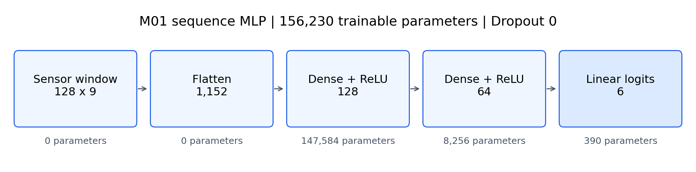

# 공동 논문에 넣을 MLP 압축 문단

아래는 팀 전체 1~2쪽 원고 취합에 사용할 MLP 부분이다. 전체 논문·초록·모델 순위·저자/소속은 작성한 것으로 간주하지 않는다.

동일한 128시점·9채널 센서 구간을 1,152차원으로 펼쳐 128·64차원의 ReLU 은닉층과 6개 logits 출력층으로 분류하는 MLP를 구성하였다. 파라미터 수는 156,230개이며 기존 fit 통계로 표준화를 한 번 적용하였다. Adam(학습률 0.001), batch 64, 최대 40 epoch, val_loss 기준 patience 6과 최선 가중치 복원을 사용하였다. 고정 사람 분할에서 seed 2026·2027·2028을 반복한 validation Macro F1은 **0.8646 ± 0.0125**, Accuracy 평균은 **86.67%**였다. ±는 세 학습 seed의 표본 SD다. 앉기→서기 오분류와 사람별 성능 차이를 관찰했으며, validation은 조기 종료에 사용한 개발 지표이고 공식 test는 미평가다.

| 모델 | 입력 | 파라미터 | 평가 집합 | 반복 | Macro F1 평균 ± seed 표본 SD | Accuracy 평균 |
|---|---|---:|---|---:|---:|---:|
| 시계열 MLP (M01) | 128×9 → 1,152 | 156,230 | S0 validation 1,775개 | 3 | 0.8646 ± 0.0125 | 86.67% |

그림 후보. MLP 입력·펼치기·Dense 구조와 층별 파라미터 수. 편집 가능한 원본은 architecture.svg다. 문장·수치는 [상세 원고](contribution.md) 및 [runs.csv](../../../../reports/mlp_yoonseop/runs.csv)와 연결된다. 데이터·방법 인용은 [references.md](references.md)의 UCI HAR[1,2]·Keras[3,4]·Adam[5]를 공동 참고문헌 목록에 통합한다.
