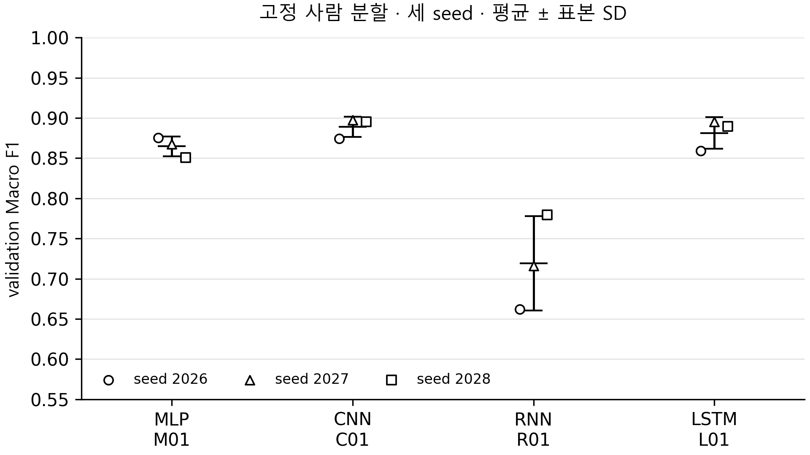

# 네 모델 취합 검증 · 2026년 10월 13일

검토한 main은 `9d1da37aaac538e0ee6fd91d2a8335795d2e469b`이다. MLP 한윤섭, CNN 최승빈, RNN 유재윤의 코드·원고·세 seed 결과가 LSTM 이봉헌 자료와 함께 main에 들어왔다. CNN은 PR #1, RNN은 PR #3의 병합 커밋을 확인했다. RNN 게시 영수증의 `main_merged: false`는 게시 당시 기록이며 현재 main 병합 상태와 다르다.

## 확인한 실제 결과

| 모델 | 조건 | 파라미터 | Dropout | Accuracy 평균 ± SD | Macro F1 평균 ± SD |
| --- | --- | ---: | ---: | ---: | ---: |
| MLP | M01 | 156,230 | 0 | 0.8667 ± 0.0117 | 0.8646 ± 0.0125 |
| CNN | C01 | 85,574 | 0.3 | 0.8888 ± 0.0116 | 0.8889 ± 0.0127 |
| RNN | R01 | 1,542 | 0 | 0.7356 ± 0.0497 | 0.7191 ± 0.0586 |
| LSTM | L01 | 21,222 | 0 | 0.8832 ± 0.0194 | 0.8813 ± 0.0195 |

모든 수치는 **개발용 validation**, 0~1 비율이며 ±는 동일 사람 분할의 seed 3개에 대한 표본 SD다. Accuracy를 백분율로 바꾸면 SD도 %p로 함께 바꾼다. 공식 test 성능이나 신뢰구간으로 표현하지 않는다.

RNN 담당자는 개인 사전 규약에 따라 R02를 튜닝 결과로 선택했다. R02(은닉 64, 5,126개)의 Macro F1은 0.7715 ± 0.0675, Accuracy는 0.7855 ± 0.0605다. 위 표는 기본 조건 R01을 유지한 **공동 비교 초안**이다. R02를 최종 비교 대상으로 쓰려면 다른 모델의 탐색 예산·선택 규칙도 함께 명시해 팀에서 확정한다. R01과 R02 결과를 섞어 평균내지 않았다.

## 원자료 재계산

- 기준 4모델 × seed 3개 = 12회, RNN 선택 조건 R02의 3회를 추가해 **15회·26,625개 예측 행**을 검사했다.
- 1,775개 validation의 sample_id·사람·정답·행 순서가 모든 실행에서 정확히 일치한다. fit 5,577개와 validation의 ID·사람은 겹치지 않는다.
- 실제 split.json 목록, 0 시작 원본 행 번호, 채널·라벨 순서, 데이터·통계·행 바인딩 해시가 일치한다.
- 저장된 fit 통계의 표준화 1회, 통계 재추정 없음, 개발 경로의 test 배열 미로딩을 metadata에서 확인했다.
- 확률의 유한성·합계·logits softmax·예측 argmax를 검사하고, 6×6 혼동행렬에서 Accuracy와 여섯 클래스 Macro F1을 재계산했다. 모든 실행 지표와 원래 게시한 요약값에 1e-12 이내로 일치했다.
- 팀원들이 저장한 전체 validation 모델 재로딩·새 프로세스 검증 기록은 통과 상태다. 이번 검토에서는 그 기록과 예측을 검사했으며, 모든 모델을 새로 재로딩하거나 재학습한 것은 아니다.
- 통합 main의 코드 테스트는 저장소 루트에서 68개를 통과했다. 최초 검사는 제가 저장소 바깥에서 실행해 모듈 검색이 실패했다. 이는 실행 위치 오류이며 팀 모델 결함으로 서술하지 않는다.

검증 결과: [audit.json](../../../reports/team_comparison/audit.json). 원자료 해시, 실행별 재계산, 사람별 결과, 같은 seed의 모델 간 차이는 [reports/team_comparison](../../../reports/team_comparison/)에 있다.

## 비교의 범위

CNN과 LSTM의 Macro F1 평균 차이는 0.0076다. 세 seed 모두 CNN 값이 높지만, 단일 분할·세 seed·epoch 선택에 사용한 validation에서의 관찰이다. 통계적 유의성이나 새로운 사람 모집단에서의 우월성을 입증한 것으로 쓰지 않는다.

CNN의 Dropout은 0.3이고 다른 기본 모델은 0이다. RNN과 LSTM은 은닉 크기 32와 64, 분류 헤드와 파라미터 수도 다르다. 따라서 비교 대상은 **각 담당자가 제출한 고정 모델 구성**이다. 게이트 유무만 바꾼 통제 실험, 같은 파라미터 예산, 모든 모델에 동일한 최적화·탐색 기회를 적용한 결과라고 주장할 수 없다.

각 실행 PC와 Python·NumPy 버전이 다르다. TensorFlow 2.21.0·Keras 3.15.1·CPU 스레드 4 등의 공통점과 차이를 실행별 CSV에 남겼다. 개인 PC의 학습 시간이나 추론 시간으로 모델 속도 순위를 만들지 않았다.

## 논문과 그림 취합

그림 후보 1. 각 담당자의 실제 기본 모델 구조. PNG는 한 단 폭 80 mm, 600 dpi이며 SVG는 수정할 수 있다. CNN의 두 풀링 뒤 세 번째 합성곱과 GAP까지 표시했다. 최종 출력은 softmax를 포함하지 않는 logits다. 그림에서는 Dropout 0인 층을 생략했다. RNN 그림은 R01이며 R02를 선택할 경우 구조와 파라미터 표기를 함께 바꾼다.

그림 후보 2. 점은 개별 seed, 검은 막대는 평균 ± 표본 SD다. 최종 1~2쪽 원고에는 구조 그림과 결과 그래프를 모두 넣기보다 구조 그림 1개와 네 모델 비교표 1개를 우선 고려한다. 상세 그래프·오류·수학 검산은 개인 보고서와 발표에 둔다.

## 남은 확정 사항

1. RNN R01 기본 비교와 R02 튜닝 결과 중 최종 본문의 대표 범위·선택 규칙을 전원이 확인한다. 이번 표는 R01 기준 초안이다.
2. 정회서의 실제 데이터·전처리 설명을 취합한다. 입력 코드와 실험 분할 근거는 있지만 별도 `contributions/01_data` 원고는 현재 찾지 못했다.
3. 저자 순서·학교·학과·이메일·교신저자·지도교수·발표자를 확정한다. 사용자 답변대로 현재 확인 필요다.
4. 공식 test 평가 대상과 시점을 팀에서 동결한다. 이번에 test를 실행하지 않았다. 개발 비교를 제출할 경우 그 범위를 명시한다.
5. [통합 MD 초안](PAPER_DRAFT_KO.md)을 실제 학생 HWP 양식에 취합하고, 그림·표·참고문헌까지 팀 전체 1~2쪽인지 다시 검증한다. 기존 2쪽 LSTM 중심 HWP는 최종 네 모델 제출본이 아니다.

## 재현

LSTM Release의 `runs/lstm`을 준비한 뒤 저장소 루트에서 `python tools/audit_team_results.py --lstm-runs runs/lstm`을 실행한다. 다른 담당자 예측은 Git에 있다. `--output`으로 새 출력 폴더를 지정할 수 있다. 검사 실패 시 기존 실행·예측을 수정해 맞추지 말고 원인을 확인한다.

담당 근거: [MLP 원고](../contributions/02_mlp/contribution.md), [CNN 정식 TensorFlow 원고](../contributions/03_cnn/final_tensorflow_results.md), [RNN 원고](../contributions/04_rnn/contribution.md), [LSTM 압축 원고](../contributions/lstm-compact/README.md). 저장 모델: [MLP Release](https://github.com/kara320090/smartphone-har/releases/tag/yoonseop-mlp-v1), [RNN Release](https://github.com/kara320090/smartphone-har/releases/tag/yu-jaeyun-rnn-v1), [LSTM Release](https://github.com/kara320090/smartphone-har/releases/tag/bongheon-lstm-v1); CNN 모델은 `artifacts/cnn_tensorflow/`에 있다.
